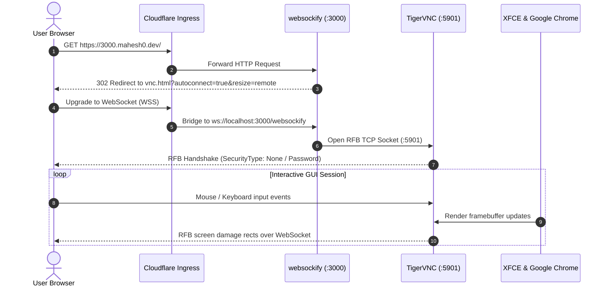

# Ingress & Connectivity

Every Modal sandbox includes pre-configured network ingress, allowing both command-line SSH access and public HTTPS web access without opening external firewall ports.

## 1. OpenSSH Server (Port 2222)

Each sandbox runs an OpenSSH server listening on internal port `2222`, tunnelled through Modal's container network interface.

### Key Management & Configuration
- **Public Key**: The public key is tracked in [`shared/ssh-key.pub`](file:///root/.t3/worktrees/software-factory/t3-a5492fd9/shared/ssh-key.pub) and automatically authorized inside the sandbox `authorized_keys`. Developers can override this by defining `SSH_AUTHORIZED_KEY` in `.env`.
- **Private Key**: The default private key is stored locally at `~/.ssh/modal-sandbox`.
- **Automatic `~/.ssh/config` Injection**: Unless disabled via `--no-ssh-config`, the runner appends a Host entry to your local `~/.ssh/config` upon launch (see [ADR 0041](../adr/0041-automatic-ssh-config-registration-for-sandboxes.md)):

```ssh-config
Host dev-box
    HostName <modal-tunnel-host>
    Port <forwarded-port>
    User root
    IdentityFile ~/.ssh/modal-sandbox
    StrictHostKeyChecking no
    UserKnownHostsFile /dev/null
```

This lets you connect simply by typing:

```bash
ssh dev-box
```

---

## 2. Cloudflare Tunnel Web Ingress (Port 3000)

By default, every sandbox spins up a background [Cloudflare Tunnel](https://developers.cloudflare.com/cloudflare-one/connections/connect-networks/) client (`cloudflared`) targeting container port `3000`.

- **Quick Tunnels**: With no credentials configured, `cloudflared` registers a free temporary quick tunnel (`https://<random-id>.trycloudflare.com`).
- **Custom Domains**: By providing `CLOUDFLARE_TUNNEL_TOKEN` and optional `MODAL_SANDBOX_TUNNEL_DOMAIN` in `.env`, the tunnel binds to your custom domain (such as `https://3000.mahesh0.dev`).
- **Opt-Out**: If you do not require web ingress, pass `--no-cloudflare` to save startup overhead.

```bash
# Launch without Cloudflare Tunnel
modal-sandbox --name minimal-box --no-cloudflare
```

---

## 3. noVNC Web Ingress & Desktop WebSocket Streaming

When an interactive XFCE desktop is launched with `--xfce`, the sandbox routes the desktop display through `websockify` on port `3000` (or a custom port specified via `--xfce-port`).

The ingress pipeline provides instant, zero-client browser access:
1. **Root Redirection**: When a browser navigates to the public Cloudflare Tunnel URL, `/usr/share/novnc/index.html` immediately redirects to `vnc.html?autoconnect=true&resize=remote`.
2. **WebSocket Upgrade**: The browser upgrades the HTTP connection to a secure WebSocket (`wss://`) carrying RFB (Remote Framebuffer) protocol traffic.
3. **Bridge Translation**: `websockify` unmasks WebSocket frames and bridges raw TCP bytes to TigerVNC on `localhost:5901`.
4. **Interactive Session**: Mouse movements, keypresses, and framebuffer damage rectangles stream bidirectionally with low latency.

### Desktop Ingress Sequence



---

## 4. Dedicated Agent & Bundler Ingress Ports

When specialized tooling flags are enabled, additional secure tunnels or ingress endpoints are created:

| Tooling Flag | Forwarded Port | Description |
| :--- | :--- | :--- |
| Default | `3000` | Application web servers (Vite, Next.js, FastAPI) |
| `--xfce` | `3000` (or `--xfce-port`) | XFCE noVNC browser desktop & Google Chrome GUI |
| `--opencode` | `4096` | OpenCode web IDE server |
| `--t3` | `3775` | T3 Code server web pairing endpoint |
| `--react-native` | `8081` | React Native Metro bundler tunnel |
