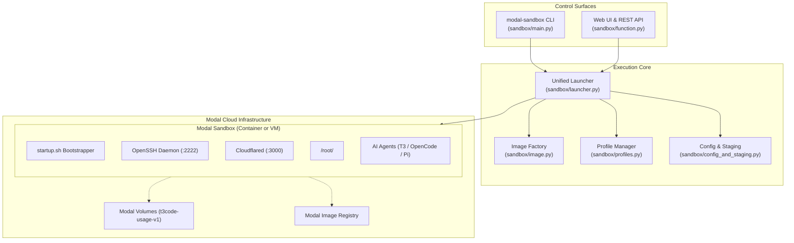

# Architecture Overview

Modal Sandboxes provides a unified architecture for spinning up, connecting to, and managing isolated cloud execution environments.

## System Topology

## Architectural Components

### 1. Control Surfaces
- **`modal-sandbox` CLI**: The primary entry point for developers. Parses flags, resolves local configuration, establishes SSH keys, and interacts with Modal's API.
- **Serverless Web Control Plane**: A FastAPI application hosted via `modal.fastapi_endpoint` in `sandbox/function.py`. Exposes an authenticated dashboard (`GET /`) and REST API (`POST /api/sandboxes`, `POST /launch`, etc.).

### 2. Execution Core
- **`sandbox/launcher.py`**: The unified sandbox runner. Orchestrates sandbox creation for both standalone and repository-backed runs, whether targeting standard containers or Linux VMs.
- **`sandbox/image.py`**: Composable image definitions using `modal.Image`. Prebakes dependencies, developer utilities, and optional toolchains.
- **`sandbox/config_and_staging.py`**: Stages configuration files, environment variables, startup scripts, and credentials into sandbox directories (`.secrets/`, `.scripts/`).

### 3. In-Sandbox Bootstrap
- **`startup.sh`**: Runs as the entrypoint inside the sandbox. Starts `sshd`, executes cloudflared ingress, provisions optional agent tools, clones target repositories, and scrubs sensitive bootstrapping keys.

### 4. Storage & Persistence
- **Filesystem Snapshots**: Fast copy-on-write filesystem images leveraging `modal.Image.from_id()`.
- **Persistent Volumes**: Dedicated Modal volumes (e.g., `t3code-usage-v1`) that preserve agent transcripts and cache data across sandboxes.
