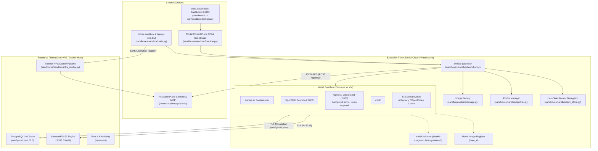

# Architecture Overview

Software Factory provides a cohesive monorepo architecture partitioning cloud execution environments, the browser control plane UI, persistent database and storage infrastructure, and the starter application blueprint (see [ADR 0081](../adr/0081-monorepo-architecture-for-execution-and-resource-planes.md), [ADR 0087](../adr/0087-app-template-and-scaffolder-integration.md), and [ADR 0096](../adr/0096-nextjs-sandbox-dashboard-and-bff.md)):

1. **Execution Plane (`sandboxes/`)**: Ephemeral, isolated cloud containers and Linux VMs running on [Modal](https://modal.com) with OpenSSH, Cloudflare ingress, integrated AI developer tooling, the Python App Scaffolder (`create-app`), and the serverless FastAPI control plane (`sandboxes/sandbox/function.py`).
2. **Sandbox Dashboard (`dashboard/`)**: Modular Next.js 16 + React 19 **Sandbox Web Dashboard** and same-origin Basic-Auth BFF proxy (`dashboard/apps/web`) hosted on the VPS (`/opt/sandbox-dashboard`) behind Caddy (`https://<APPS_BASE_DOMAIN>`).
3. **Resource Plane (`resource-plane/`)**: Stateful persistence and control plane subsystem hosted on a dedicated Linux VPS or local Docker environment, providing isolated PostgreSQL 16 databases, SeaweedFS S3 object storage buckets, root TLS CA generation, interactive web console, and an MCP server (`POST /api/mcp`).
4. **App Template (`app-template/`)**: Canonical Next.js 16 + optional Expo React Native starter blueprint materialized by `create-app` (and staged into `/opt/app-template` inside Modal sandboxes).

---

## System Topology

---

## Architectural Subsystems

### 1. Execution Plane (`sandboxes/`)

- **`sandboxes/sandbox/main.py`**: The primary CLI entrypoint (`modal-sandbox`). Parses runtime flags, resolves local configuration, triggers snapshots, and dispatches subcommands (including `modal-sandbox infra deploy`).
- **`sandboxes/sandbox/function.py`**: Serverless FastAPI control plane hosted via `@modal.asgi_app()`. Exposes the REST API (`POST /api/apps`, `GET /api/primes`, `GET /api/github/repos`, `GET /api/sandboxes/costs`, `POST /api/sandboxes`, `POST /launch`, etc.), spawned `Launch Request` worker (`run_launch_request`), serialized **Factory State Authority** (`factory-state-v1`), and minimal authenticated status page (`GET /`).
- **`sandboxes/sandbox/launcher.py`**: Unified sandbox runner orchestrating container and Linux VM creation via the Modal client SDK.
- **`sandboxes/shared/image.py`**: Composable base and runtime image definitions with prebaked developer utilities and toolchains.
- **`sandboxes/sandbox/env_store.py`**: Retrieves and decrypts target repository secrets host-side from the Central Config Store (`config` under `env/<repo>/`) before injecting them into sandboxes via `modal.Secret`.
- **`sandboxes/shared/startup.sh`**: Runs as the entrypoint inside the sandbox container. Starts `sshd`, executes cloudflared ingress, configures AI developer harnesses, clones target repositories, and materializes local `.env` files.
- **Filesystem Snapshots & Volumes**: Copy-on-write image capture leveraging `modal.Image.from_id()` and persistent storage for agent usage metrics (`t3code-usage-v1`) and Factory App metadata (`factory-state-v1`) via `modal.Volume`.

### 2. Sandbox Dashboard (`dashboard/`)

- **`dashboard/apps/web`**: Next.js 16 + React 19 UI providing the Builder (`/`), Sandboxes (`/sandboxes`), Snapshots (`/snapshots`), and Scratchpad (`/scratchpad` Ideas & Raw) views.
- **Same-Origin BFF Proxy**: Next.js middleware enforces HTTP Basic Authentication (`WEB_UI_USERNAME` / `WEB_UI_PASSWORD`) and forwards `/api/[...path]` (with SSE streaming support) to `SANDBOX_CONTROL_PLANE_URL`.
- **VPS & Apex Routing**: Deployed to `/opt/sandbox-dashboard` via `modal-sandbox infra dashboard` and served at `https://<APPS_BASE_DOMAIN>` under Caddy split apex routing (`--cutover`), keeping Modal CLI paths (`/launch`, `/snapshot`, `/health`, `/api/codex/profiles`) routed directly to Modal.

### 3. Resource Plane (`resource-plane/`)

- **Dedicated Persistence Architecture**: Outlined in detail in the [Resource Plane Architecture](resource-plane.md).
- **Turnkey Infrastructure Deployment**: Automated remote VPS provisioning via `modal-sandbox infra deploy` (see [Resource Plane VPS Deployment Guide](../guides/resource-plane-deployment.md)).
- **Dual Runtimes**: Production deployment to Linux VPS over SSH, or a local Next.js development server whose Auto-Bootstrapper manages Docker services. Default Compose alone provides only PostgreSQL and SeaweedFS.

### 4. App Template and Hosted Apps

`app-template/` is excluded from the factory pnpm workspace and copied into independent projects by `create-app`. Cloud wiring can create GitHub repositories, persistence resources, vault files, and a development sandbox. Host-side `deploy-app` transfers a generated app or pulls its GitHub source to `/root/<repo-name>` on the VPS, builds it, and routes it through wildcard Caddy ingress at `/opt/caddy`.

See [application creation and deployment](../guides/applications.md). The Caddy and app deployment configuration is separate from sandbox Cloudflare tunnels. Filesystem snapshots and persistent volumes may retain credentials; see [secrets](secrets.md) before sharing them.
