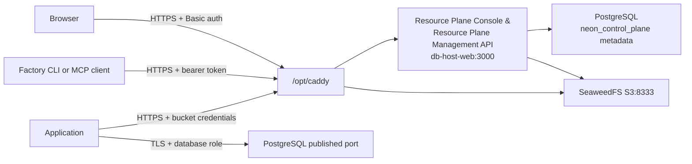

# Resource Plane Architecture

The Resource Plane provides persistent PostgreSQL databases and S3 buckets for applications developed in Modal sandboxes or on workstations. The Next.js 16 / React 19 application provides the Resource Plane Console and Resource Plane Management API over MCP, alongside PostgreSQL 16 and SeaweedFS containers. Resource Plane Projects group application databases and object storage independently of T3 Projects and Builder Workspaces.

## Topology

Production runs `web`, `postgres`, and `seaweedfs` from `docker-compose.prod.yml` on the external `dbhost-network`. Caddy is a sibling stack at `/opt/caddy`; the Resource Plane defaults to `/opt/resource-plane`. Local development runs the Next.js process on the host and lets its bootstrapper manage service containers through the Docker socket.

The default `docker-compose.yml` contains only PostgreSQL and SeaweedFS. It does not launch the Resource Plane Console or perform the full production preflight. Follow [deployment](../guides/resource-plane-deployment.md) for complete local or production setup.

## Authentication and API

The Resource Plane Console uses `BASIC_AUTH_USERNAME` / `BASIC_AUTH_PASSWORD`, falling back to `CONTROL_PLANE_USERNAME` / `CONTROL_PLANE_PASSWORD`. These are separate from the Sandbox Web Dashboard's `WEB_UI_*` credentials. Production setup generates Resource Plane Console Credentials; local development must explicitly configure one to require Basic authentication.

The Resource Plane Management API endpoints `POST /api/mcp` and the compatibility `POST /mcp` route use the server's `ADMIN_TOKEN` (fallback `NEON_ADMIN_TOKEN`). Factory clients supply that value through `RESOURCE_PLANE_ADMIN_TOKEN` or the legacy `DB_HOST_ADMIN_TOKEN`.

The server in `apps/web/mcp/server.ts` registers these eight tools:

| Tool | Purpose |
| :--- | :--- |
| `list_projects` | List Resource Plane Projects |
| `create_project` | Create a Resource Plane Project |
| `create_database` | Create a database with a dedicated role |
| `list_databases` | List a Resource Plane Project's databases |
| `get_database_credentials` | Retrieve a database connection and credentials |
| `create_object_storage` | Create an S3 bucket with dedicated credentials |
| `list_object_storages` | List a Resource Plane Project's buckets |
| `get_storage_credentials` | Retrieve bucket access and endpoint details |

The HTTP route handles JSON-RPC POST requests; it does not expose a GET SSE stream. A separate stdio entrypoint is available through `pnpm --filter @repo/web mcp`. Public `GET /api/ca.crt` serves the PostgreSQL root CA; `GET /api/health` reports PostgreSQL and SeaweedFS status without Basic authentication.

## Database and storage isolation

The System Database is `neon_control_plane`. Databases in Resource Plane Projects have individual Resource Roles and passwords, with names generated from the database name and a random suffix. Public PostgreSQL access uses TLS and client connection strings with `sslmode=verify-full` and a root CA certificate. Configure `PUBLIC_POSTGRES_HOST` to match the hostname or IP used by clients.

SeaweedFS provides per-bucket IAM access and secret keys. Port 8333 serves the S3 HTTP API; public HTTPS requires a configured proxy hostname. Its internal filer port 8888 is not published by the Compose stacks.

## Ports and storage

Fresh production setup writes `POSTGRES_PORT=5432`, `WEB_PORT=3000`, and `S3_PORT=8333` to its `.env`. Existing installations can use other values, including PostgreSQL port 54320. Read the actual Compose binding and generated connection details rather than assuming one external PostgreSQL port. The bare production Compose file's public-port metadata fallback differs from its binding fallback; running `deploy.sh` produces explicit settings for both.

Production data lives under `/opt/resource-plane/.data/`, including `postgres/`, `seaweedfs/`, and `certs/`. Host development defaults to `.data/` relative to the web process working directory (`resource-plane/apps/web/`). Caddy certificates and configuration have their own volumes and backup lifecycle.

## Deployment boundary

Host deployment commands use `RESOURCE_PLANE_SSH_KEY` over SSH. Runtime clients use the Resource Plane Management API Admin Token, database Resource Roles, and bucket-scoped Storage Credentials. Keep deployment keys on the deployment host; avoid mapping them into application repositories through `config/env/`. See [secrets](secrets.md) for actual injection and filesystem behavior.
