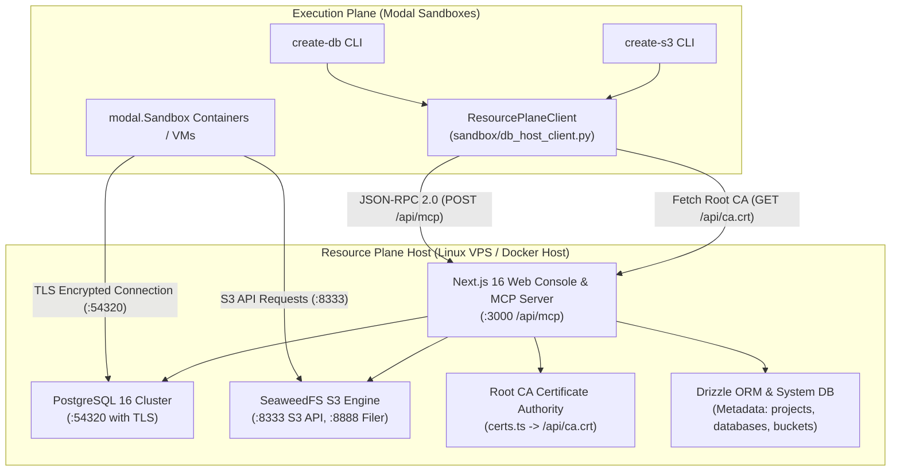

# Resource Plane Architecture

The **Resource Plane** (`resource-plane/`) is the stateful persistence and control plane subsystem of Software Factory. Hosted on a dedicated Linux VPS or local Docker environment, it provides isolated PostgreSQL databases, SeaweedFS S3 object storage buckets, root TLS certificate generation, an interactive web dashboard, and Model Context Protocol (MCP) tool endpoints for AI coding agents.

---

## Subsystem Architecture

---

## Core Components

### 1. Web Console & MCP Server (`apps/web`)
A Next.js 16 App Router (React 19, Tailwind CSS) web application serving two roles:
- **Interactive Persistence Console (`GET /`)**: Protected by HTTP Basic Authentication (`BASIC_AUTH_USER` / `BASIC_AUTH_PASS`), enabling developers to view projects, inspect provisioned databases and S3 buckets, run SQL scratchpad queries, browse object buckets, and download the root CA certificate.
- **Model Context Protocol (MCP) Server (`POST /api/mcp`)**: A JSON-RPC 2.0 endpoint protected by `RESOURCE_PLANE_ADMIN_TOKEN` (or legacy `DB_HOST_ADMIN_TOKEN`). Exposes automated tool primitives for AI agents and CLI clients:
  - `ensure_project`: Creates or resolves tenant project scopes.
  - `provision_database`: Allocates isolated PostgreSQL databases and role credentials.
  - `provision_bucket`: Allocates SeaweedFS S3 buckets with dedicated IAM credentials.
  - `list_projects`, `list_databases`, `list_buckets`: Read-only introspection tools.

### 2. PostgreSQL 16 & Resource Role Isolation
Relational database storage is powered by official PostgreSQL 16 with cryptographic and permission boundaries:
- **Per-Database Role Isolation**: Every provisioned database receives a dedicated unprivileged PostgreSQL user role (`role_<project>_<dbname>`) restricted exclusively to its assigned database.
- **Encrypted In-Transit (TLS)**: Connections on public port `54320` require SSL/TLS (`sslmode=verify-ca` or `verify-full`). Server certificates are dynamically generated and signed by the internal Root CA.
- **System Metadata Separation**: Operational metadata (projects, API tokens, provisioned entities) is housed in an internal `system_db` separate from tenant databases.

### 3. SeaweedFS S3 Object Storage
High-performance distributed object storage compatible with the AWS S3 API:
- **Dedicated Bucket IAM**: Each bucket provisioned via MCP receives unique Access Key and Secret Key pairs, preventing cross-bucket access.
- **Standard S3 Compatibility**: Seamlessly integrates with AWS SDKs (Python `boto3`, Node `@aws-sdk/client-s3`, AWS CLI) by specifying endpoint `https://<resource-plane-domain>:8333` (or port-forwarded/proxied hostname).
- **Internal Filer**: SeaweedFS master and volume servers manage storage blocks while isolating internal administrative filer ports (`8888`) from public access.

### 4. Root CA Certificate Authority
The Resource Plane includes a self-contained Certificate Authority service (`services/certs.ts`):
- Generates a local root private key and self-signed Root CA certificate (`ca.crt`).
- Issues TLS server certificates for the PostgreSQL listener.
- Publishes the public root certificate at unauthenticated endpoint `GET /api/ca.crt`, allowing `ResourcePlaneClient` (`sandbox/db_host_client.py`) to automatically download and cache it locally (`~/.config/resource-plane/ca.crt`).

---

## Security & Transport Boundaries

Software Factory enforces a strict separation between deployment and runtime transports (see [ADR 0081](../adr/0081-monorepo-architecture-for-execution-and-resource-planes.md)):

| Access Boundary | Transport & Protocol | Credentials Used | Isolation Guarantee |
| :--- | :--- | :--- | :--- |
| **Infrastructure Deployment** | SSH (`port 22`) via native `ssh` / `tar` | Host SSH private key (`RESOURCE_PLANE_SSH_KEY`) | Executed strictly from host developer workstation or deployment CI; SSH keys are **never** bundled or injected into Modal Sandboxes. |
| **Control Plane API (MCP)** | HTTPS (`port 3000`, `POST /api/mcp`) | Bearer token (`RESOURCE_PLANE_ADMIN_TOKEN`) | Ephemeral sandboxes and CLI utilities interact exclusively over HTTP JSON-RPC; no filesystem or container access to the host VPS. |
| **Database Connections** | TLS TCP (`port 54320`) | Discrete DB Role credentials + cached `ca.crt` | Each sandbox connects only to its assigned database with scoped privileges. |
| **Object Storage Access** | S3 HTTP/HTTPS (`port 8333`) | Discrete S3 IAM Access/Secret Keys | Access is scoped strictly to the target bucket. |
