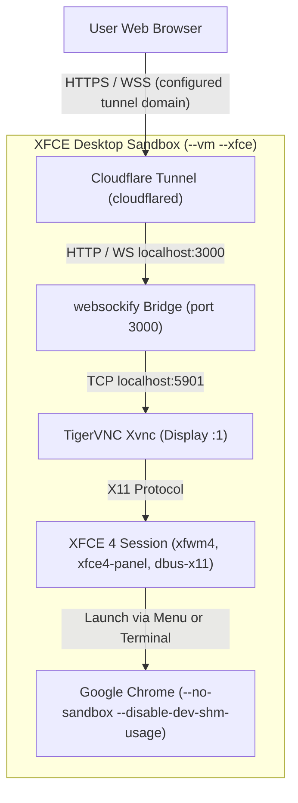

# Execution Runtimes: Standard Sandboxes and VM Sandboxes

Development Sandboxes support two runtimes: Standard Sandbox and VM Sandbox. Standalone Sandbox describes the initial repository setup, and Prime Sandbox describes sharing and reuse; both are independent of the runtime choice. A Standalone Sandbox starts without a selected Target Repository and can acquire workspaces later, including when used as a Prime Sandbox.

## Runtime Comparison

| Dimension | Standard Sandbox | VM Sandbox (`--vm`) | XFCE Desktop Sandbox (`--xfce`) |
| :--- | :--- | :--- | :--- |
| **Modal Runtime** | gVisor Container (`runtime="gvisor"`) | Stable VM (`runtime="vm"`) | Stable VM (`runtime="vm"`) |
| **CLI Flag** | Default | `--vm` | `--xfce` (implies `--vm`) |
| **Docker-in-Docker** | No (restricted permissions) | **Yes** (dockerd pre-configured) | **Yes** (dockerd pre-configured) |
| **Kernel Privileges** | Restricted container namespace | Full Linux kernel privileges | Full Linux kernel privileges |
| **RAM Configuration** | Burstable `(128, 16384)` MiB | Burstable `(128, 16384)` MiB | Burstable `(128, 16384)` MiB |
| **Display Server** | None (headless) | None (headless) | **X11 Display :1 (TigerVNC + noVNC)** |
| **Desktop / Browser** | Headless Playwright Chromium optional (`--browser`) | Headless Playwright Chromium optional (`--browser`) | **XFCE 4 Desktop + Google Chrome** |
| **Swapfile Support** | Disabled | Automatically allocated | Automatically allocated |
| **Best For** | Python apps, web APIs, scripts, AI agents | Docker compose, integration tests, custom daemons | Visual E2E testing, browser UI debugging, web desktop |

---

## 1. Standard Sandbox

Standard Sandboxes run on Modal's lightweight container runtime. Startup time depends on image caching and repository setup. These sandboxes support:

- Running Python, TypeScript, and Go development tools.
- Hosting web development servers (Next.js, FastAPI, Vite).
- Using T3 Code with Antigravity, OpenCode, and Codex providers.
- Inspecting code with remote SSH shells.

```bash
# Provision a Standard Sandbox
modal-sandbox --name dev-box
```

---

## 2. VM Sandbox (`--vm`)

When `--vm` is specified, the launcher instructs Modal to boot a virtual machine with full kernel isolation (see [ADR 0031](../adr/0031-migrate-vm-runtime-to-modal-stable-runtime.md)).

Key capabilities include:
- **Docker Daemon**: The VM boots with an active Docker daemon. You can run `docker build`, `docker run`, and `docker compose up` directly inside the sandbox.
- **Custom System Daemons**: Run background services and daemons with the VM runtime. Factory startup launches services directly; a full `systemd` boot is not provisioned.
- **Swap Allocation**: Swapfile memory allocation is managed automatically to handle intensive build tasks.

```bash
# Provision a VM Sandbox with Docker support
modal-sandbox --name vm-box --vm
```

Inside the VM Sandbox:

```bash
ssh <printed-instance-alias> "docker --version && docker run hello-world"
```

---

## 3. XFCE Desktop Sandbox (`--xfce`)

When `--xfce` is specified, the launcher automatically provisions an XFCE Desktop Sandbox backed by a VM Sandbox, with a full XFCE 4 graphical desktop, TigerVNC X11 server, noVNC web client, and Google Chrome (see [ADR 0070](../adr/0070-xfce-desktop-and-chrome-in-vm-sandboxes.md)).

Passing `--xfce` automatically enforces VM Sandbox mode (`vm=True`) because graphical desktop environments, IPC message buses (`dbus-x11`), and modern web browsers require full `/dev/shm` shared memory access and burstable RAM up to 16 GiB.

### Architecture



### Components

- **XFCE 4 Desktop**: Complete lightweight desktop suite including `xfwm4` window manager, `xfce4-panel`, desktop application launcher, and `xfce4-terminal`.
- **TigerVNC (`Xvnc`)**: Headless X11 display server listening locally on RFB port `5901` (`Display :1`). Patched Perl wrapper prevents cleanup race conditions when backgrounded.
- **noVNC + websockify**: Serves the browser-based VNC client and bridges WebSocket traffic directly to TigerVNC on port `3000`. Features auto-connection and remote viewport resizing.
- **Google Chrome**: Pre-installed `google-chrome-stable` patched with root container compatibility flags (`--no-sandbox --disable-dev-shm-usage`) for instant launch via CLI or the desktop menu (`Applications -> Internet -> Google Chrome`).
- **Desktop Service Daemon**: Managed via `/usr/local/bin/desktop-service`, providing clean `start`, `stop`, `restart`, and `status` lifecycle control.

```bash
# Provision an XFCE Desktop Sandbox with Google Chrome
modal-sandbox --name desktop-box --xfce
```

For the default desktop port 3000, configure a Cloudflare tunnel token and route before using its hostname. A custom `--xfce-port` also receives a Modal HTTPS endpoint. You can use SSH forwarding when public ingress is unnecessary. See [ingress](ingress.md) for transport details.

## Python dependency installation

The base image includes Python 3.12. `--modal` enables workspace virtualenv creation, Modal Profile setup, and installation from the target repository's `requirements.txt`; it requires valid `MODAL_TOKENS`. A fresh Software Factory repository launch installs `.[dev,docs]` through that requirements file, including Zensical. Ordinary standalone launches do not automatically create a virtualenv.

Snapshot restores preserve the existing workspace and virtualenv and skip dependency installation. Install updated requirements manually when restoring an older image. See [snapshots](snapshots.md).
