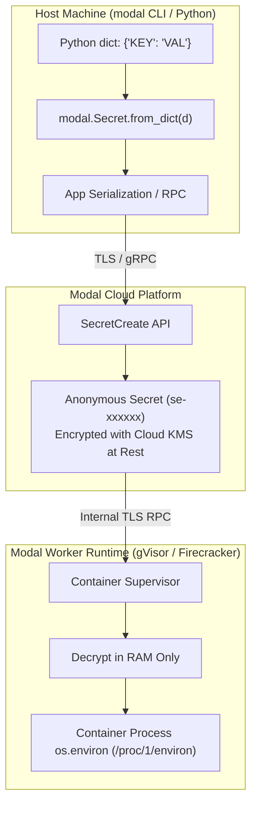
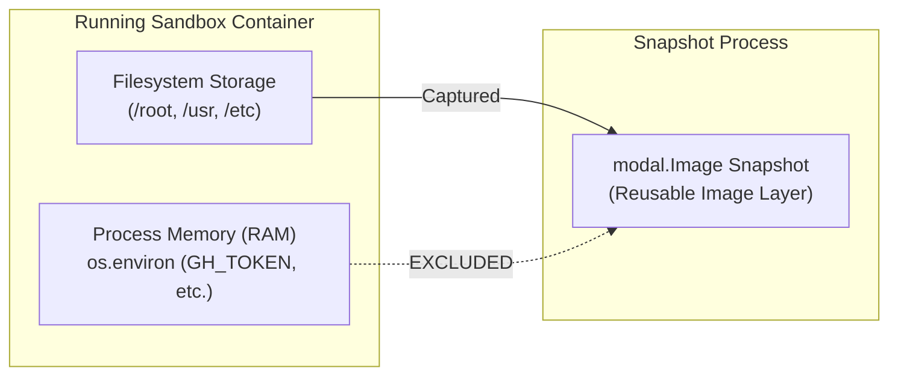
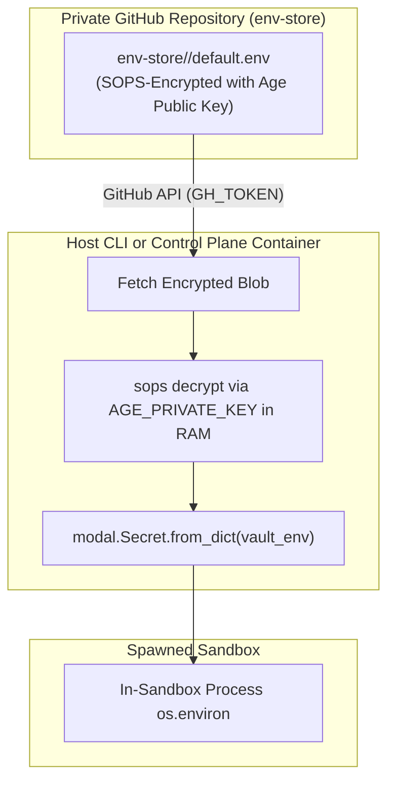

# Secrets & Security Architecture

Modal Sandboxes enforces a defense-in-depth model for managing API keys, SSH credentials, and environment variables across local terminals, cloud control planes, and running sandboxes.

## Credential Tiers

| Tier | Required Secrets | In-Sandbox Scope | Use Case |
| :--- | :--- | :--- | :--- |
| **Tier 0: Standalone Sandbox** | None (`modal setup` only) | No external secrets injected | Basic development, quick tests, public tools |
| **Tier 1: Repository Clones** | `GH_TOKEN`, `GH_ORG_NAME` | Git clone and GitHub CLI access | Working on private/organization GitHub repos |
| **Tier 2: Ingress & Cloudflare** | Optional `CLOUDFLARE_TUNNEL_TOKEN` | Tunnel authentication | Stable custom web domains |
| **Tier 3: AI Tooling** | `ANTIGRAVITY_TOKENS`, `OPENCODE_GO_API_KEY` | Provider API access | Running autonomous or paired coding agents |
| **Tier 4: Encrypted Repo Secrets** | `AGE_PRIVATE_KEY` (Host-side only) | Decrypted variables in process environment | Running target applications requiring `.env` |

---

## 1. Modal Secret Injection & Runtime Decryption

All runtime credentials are injected into Modal cloud containers using native Modal Secrets (`modal.Secret.from_dict()` or `modal.Secret.from_dotenv()`), eliminating plaintext files from container image filesystems (see [ADR 0053](../adr/0053-consolidate-secrets-to-single-dotenv-and-retire-legacy-staging.md)).

### How `modal.Secret.from_dict()` Operates Under the Hood:

1. **In-Memory Serialization**: The local CLI serializes the key-value dictionary into a Protocol Buffer payload transmitted over TLS to Modal's `SecretCreate` API.
2. **Anonymous Handle Generation**: Rather than creating a named, dashboard-visible secret entity, Modal generates an ephemeral, anonymous secret handle (e.g. `se-xxxxxxxxxxxx`).
3. **KMS Envelope Encryption at Rest**: Secrets stored in Modal's cloud metadata store are encrypted at rest using Cloud Key Management Service (KMS) envelope encryption.
4. **RAM-Only Worker Decryption**: When a container boots on a worker host, the supervisor fetches the secret over internal RPC, decrypts the keys strictly into volatile memory (RAM), and binds them to the initial process environment block (`/proc/1/environ`).
5. **Zero Disk Footprint**: At no point are secret values written to container image layers, build caches, or virtual disks.

---

## 2. Secret Storage, Retention & Lifecycle Matrix

The lifetime of secrets injected into Modal Cloud depends on the execution surface:

| Invocation / Surface | Secret Type | Storage Location | Retention Lifetime | Destruction Event |
| :--- | :--- | :--- | :--- | :--- |
| **`modal deploy sandbox/function.py`** | Anonymous `modal.Secret` | Modal Cloud KMS Vault | Persistent with deployed Modal App | When app is redeployed (`modal deploy`) or stopped (`modal app stop`) |
| **`modal serve sandbox/function.py`** | Anonymous `modal.Secret` | Modal Cloud KMS Vault | Ephemeral development session | Automatically destroyed on terminal exit (Ctrl+C) |
| **`modal-sandbox` / `Sandbox.create()`** | Anonymous `modal.Secret` | Modal Cloud KMS Vault | Ephemeral per sandbox execution | Purged immediately when sandbox terminates or reaches timeout |
| **Worker Host Execution** | Process `os.environ` | Container RAM (`/proc/1/environ`) | Runtime duration of container process | Purged on container shutdown; never written to swap or disk |

---

## 3. Filesystem Snapshot Security Guarantee

Modal Sandboxes provides point-in-time filesystem snapshots via `sandbox.snapshot_filesystem()` (see [ADR 0024](../adr/0024-filesystem-snapshots-in-unified-sandbox-runner.md) and [ADR 0048](../adr/0048-antigravity-acp-credential-preservation-in-filesystem-snapshots.md)).

- **Clean Layer Separation**: Modal filesystem snapshots capture only copy-on-write disk changes. Because credentials exist strictly in process memory (`os.environ`), **no injected secrets are baked into snapshot image layers**.
- **Safe Snapshot Sharing**: Image snapshots can be published, registered, or used to spin up fresh sandboxes across team members without leaking credentials. When a new sandbox resumes from a snapshot image, fresh secrets are re-injected dynamically via `modal.Secret.from_dict()`.

---

## 4. Host-Side Vault Decryption (`env-store`)

Target repositories often require application environment variables (database connection strings, third-party API keys). Under [ADR 0027](../adr/0057-central-env-store-and-host-side-secret-injection.md), Modal Sandboxes decouples application secrets from public git repositories:

1. **Centralized Vault**: Encrypted files live in the organization's private `github.com/${GH_ORG_NAME}/env-store` repository.
2. **Host-Side Decryption**: `SandboxLauncher` retrieves the encrypted file via the GitHub Contents API and decrypts it host-side in memory using `AGE_PRIVATE_KEY`.
3. **Container Isolation**: `AGE_PRIVATE_KEY` and the GitHub API tokens used to access `env-store` **never enter the sandbox container**.
4. **Developer Tooling & In-Sandbox Clones**: For manual or in-sandbox repository clones, `ghclone` automatically delegates to `pull-repo-env` to retrieve and decrypt secrets from `env-store` into `$TARGET_DIR/.env`. Legacy in-repo `.secrets/env.map` manifests are completely retired (see [ADR 0065](../adr/0065-retire-in-repo-env-map-and-standardize-ghclone-on-env-store.md)).

---

## 5. In-Container Filesystem Materialization

While serverless scripts read configuration from `os.environ`, frontend and backend toolchains (Next.js, Vite, Prisma, Docker Compose) require a physical `.env` file on disk.

During sandbox bootstrapping in `shared/startup.sh`:
1. Injected environment variables are materialized into `/root/<workspace-name>/.env`.
2. File permissions are strictly clamped to `chmod 0600` (readable and writable only by the root container user).
3. The root `.gitignore` is guarded to ensure local `.env` files can never be committed to Git.
