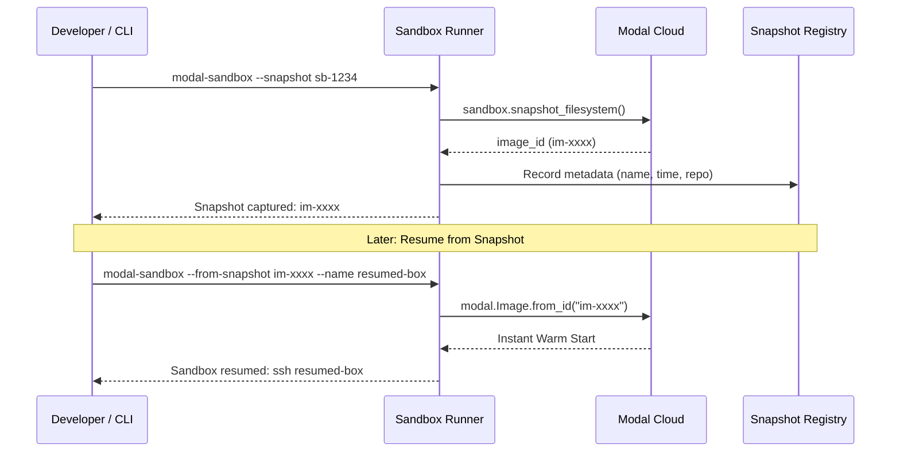

# Filesystem Snapshots & Persistence

Modal Sandboxes provides instant filesystem snapshotting and resumption powered by Modal's copy-on-write image infrastructure (see [ADR 0045](../adr/0045-filesystem-snapshots-in-unified-sandbox-runner.md) and [ADR 0084](../adr/0084-sandbox-runner-web-ui-and-snapshot-registry.md)).

## How Snapshots Work

When you capture a snapshot of a running sandbox:
1. Modal commits the modified container filesystem into a persistent `modal.Image` identifier (`im-xxxxxxxx`).
2. The image preserves all file changes in `/root`, installed system packages, virtualenv dependencies, and agent state.
3. The image is retained for a configurable TTL (default 30 days).
4. You can launch a brand-new sandbox from this snapshot in seconds, picking up right where you left off.



---

## 1. Capturing a Snapshot

Capture the current state of a running sandbox by ID:

```bash
modal-sandbox --snapshot sb-xxxxxxxx --snapshot-ttl 30
```

To automatically shut down the sandbox after capturing the snapshot:

```bash
modal-sandbox --snapshot sb-xxxxxxxx --terminate
```

---

## 2. Resuming from a Snapshot

Launch a fresh container from the captured image ID:

```bash
modal-sandbox --from-snapshot im-xxxxxxxx --name resumed-dev
```

You can also resume a snapshot into a full Linux VM environment by adding `--vm`:

```bash
modal-sandbox --from-snapshot im-xxxxxxxx --name resumed-dev --vm
```

---

## 3. Persistent Volumes

In addition to filesystem snapshots, Modal Sandboxes attaches persistent Modal Volumes for data that must survive beyond container lifecycles:

- **`t3code-usage-v1`**: Automatically mounted to `/root/.t3/usage` when `--t3` is passed, persisting AI agent transcript histories, analytics, and usage records.
- **Gradle Caches**: Cached Android SDK components and build artifacts when `--react-native` is passed.
