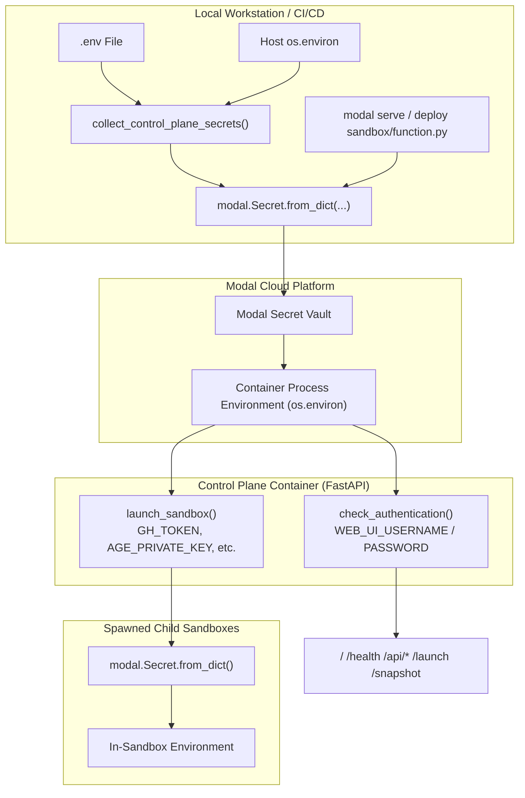
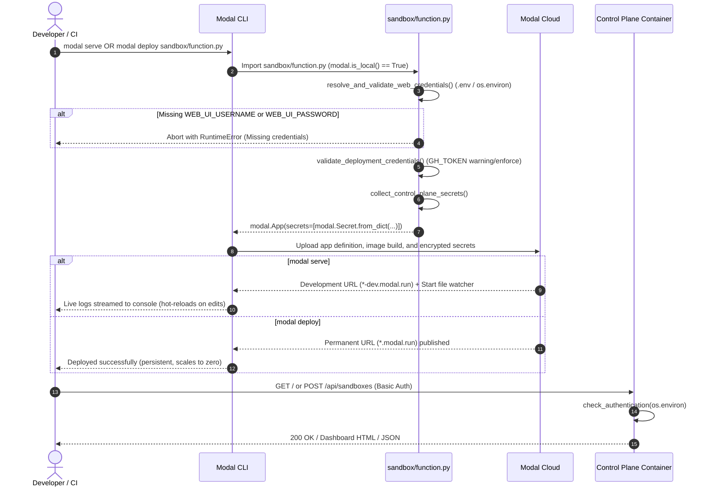

# Hosted Control Plane & Web Dashboard

Modal Sandboxes includes a serverless web dashboard and REST API implemented using FastAPI and hosted directly on Modal (`sandbox/function.py`).

## Deploying the Control Plane

### 1. Requirements in `.env`

The control plane reads configuration from process environment variables and falls back to your local `.env` file (templated in [`.env.example`](https://github.com/sFactory0/software-factory/blob/main/.env.example) at repository root; see the [Environment Variables Reference](../reference/environment.md)).

#### A. Mandatory Control Plane Authentication
Required by `resolve_and_validate_web_credentials()` at deploy/serve time. A `RuntimeError` is raised if either variable is missing:

```env
WEB_UI_USERNAME=admin
WEB_UI_PASSWORD=secure-password-here
```

#### B. Repository Sandbox Provisioning Credentials
Validated by `validate_deployment_credentials()` during deployment. While standalone sandboxes can launch without GitHub credentials, provisioning repository-backed sandboxes (`POST /api/sandboxes` or `POST /launch`) requires repository access:

```env
# GitHub Personal Access Token with repo read/clone permissions
GH_TOKEN=ghp_your_github_token_here

# Default GitHub organization for shorthand repository targets (-r <repo>)
GH_ORG_NAME=sFactory0
```

#### C. Optional Tooling, Ingress & Decryption Secrets
If defined in `.env` or set in host `os.environ`, these secrets are automatically bundled and forwarded into child sandboxes:

```env
# Ingress and SSH
CLOUDFLARE_TUNNEL_TOKEN=
MODAL_SANDBOX_TUNNEL_DOMAIN=
SSH_AUTHORIZED_KEY=

# AI Coding Providers
OPENCODE_GO_API_KEY=
ANTIGRAVITY_CLIENT_ID=
ANTIGRAVITY_CLIENT_SECRET=
ANTIGRAVITY_TOKENS='[]'

# SOPS Decryption for Target Repository Secrets (ADR 0096)
AGE_PRIVATE_KEY=
```

---

### 2. Secret Resolution & Injection Architecture

Secrets are collected on the host machine at deployment time, encrypted into a Modal Secret object, and injected as process environment variables inside the serverless container.



1. **Host-Side Collection (`modal.is_local() == True`)**:
   - `resolve_and_validate_web_credentials()` inspects `os.environ`, `.env`, `.secrets/.env`, and `secrets/.env`.
   - `collect_control_plane_secrets()` parses `.env` and merges host environment overrides.
   - Secrets are encapsulated into `modal.Secret.from_dict(...)`.
2. **Modal Cloud Injection (`modal.is_local() == False`)**:
   - Modal decrypts the secret bundle and populates `os.environ` inside the container.
3. **Child Sandbox Propagation**:
   - When `launch_sandbox()` is invoked via the Web UI or REST API, `SandboxLauncher` retrieves `GH_TOKEN`, `AGE_PRIVATE_KEY`, and ingress tokens directly from container `os.environ` and injects them into child sandboxes via `modal.Secret.from_dict()`.

> For technical details regarding KMS envelope encryption, worker RAM decryption, secret lifetimes, and filesystem snapshot guarantees, see the [Secrets & Security Architecture](../architecture/secrets.md). For resolution precedence and host environment whitelisting, refer to the [Environment Variables Reference](../reference/environment.md).

---

### 3. Operational Modes: Serve vs. Deploy

The control plane can run in two distinct operational modes:



| Feature / Behavior | Local Development (`modal serve`) | Cloud Production (`modal deploy`) |
| :--- | :--- | :--- |
| **Command** | `modal serve sandbox/function.py` | `modal deploy sandbox/function.py` |
| **Lifecycle** | Ephemeral development session. Automatically terminated on Ctrl+C. | Persistent serverless deployment. Runs continuously in Modal Cloud. |
| **URL Pattern** | Ephemeral dev URL (e.g. `https://<org>--sandbox-control-plane-fastapi-app-dev.modal.run`). | Permanent production URL (e.g. `https://<org>--sandbox-control-plane-fastapi-app.modal.run`). |
| **Secret Refresh** | Re-reads `.env` on every hot-reload and local script change. | Secret bundle is frozen at deployment time; `.env` changes require re-running `modal deploy`. |
| **Log Output** | Interactive streaming logs directly in local terminal. | Persistent log aggregation in Modal Cloud Dashboard and `modal app logs`. |
| **Scaling** | Active only while terminal process runs. | Automatically scales to zero when idle (`min_containers=0`) and warms up on demand. |

#### Local Development (Serve Mode)
Run live with hot-reloading for local testing and debugging:

```bash
modal serve sandbox/function.py
```

#### Deploy to Modal Cloud (Production Mode)
Deploy as a persistent, serverless FastAPI endpoint:

```bash
modal deploy sandbox/function.py
```

Modal will output the permanent public URL of your control plane function (e.g., `https://<org>--sandbox-control-plane-fastapi-app.modal.run`).

---

## Web Dashboard (`GET /`)

Access `GET /` in any modern web browser. You will be prompted for HTTP Basic Authentication (`WEB_UI_USERNAME` and `WEB_UI_PASSWORD`).

Key Dashboard features:
- **Active Sandbox Discovery**: View all running and paused sandboxes across all registered Modal apps (see [ADR 0086](../adr/0086-cross-app-sandbox-discovery-in-control-plane-web-ui.md)).
- **One-Click Launch**: Launch fresh standalone sandboxes or clone target GitHub repositories directly from the web interface.
- **Snapshot Registry**: Inspect captured filesystem snapshots and launch new sandboxes from existing snapshot images.
- **Instance Management**: Terminate running sandboxes and view connection parameters.

---

## REST API Reference

The control plane exposes programmatic REST endpoints for automation:

### Authentication
- All control plane endpoints (both browser UI routes under `/`, `/api/` and headless automation endpoints `/launch`, `/snapshot`) use standard HTTP Basic Authentication with `WEB_UI_USERNAME` and `WEB_UI_PASSWORD`:
  `Authorization: Basic <base64(WEB_UI_USERNAME:WEB_UI_PASSWORD)>`
- CLI commands running with `--remote` automatically authenticate using `WEB_UI_USERNAME` and `WEB_UI_PASSWORD`.

### Key Endpoints

| Method | Endpoint | Auth | Description |
| :--- | :--- | :--- | :--- |
| `GET` | `/` | Basic | Interactive web management dashboard. |
| `GET` | `/health` | None | Service liveness probe. |
| `GET` | `/api/sandboxes` | Basic | List active sandboxes across Modal applications. |
| `POST` | `/api/sandboxes` | Basic | Launch a new sandbox with custom flags and repository targets. |
| `POST` | `/api/sandboxes/{id}/terminate` | Basic | Terminate an active sandbox. |
| `POST` | `/api/sandboxes/{id}/snapshot` | Basic | Capture a filesystem snapshot of a sandbox. |
| `POST` | `/api/snapshots/{image_id}/launch` | Basic | Launch a fresh sandbox from a snapshot image. |
| `POST` | `/launch` | Basic | Headless sandbox provisioning endpoint. |
| `POST` | `/snapshot` | Basic | Headless snapshot capture endpoint. |
