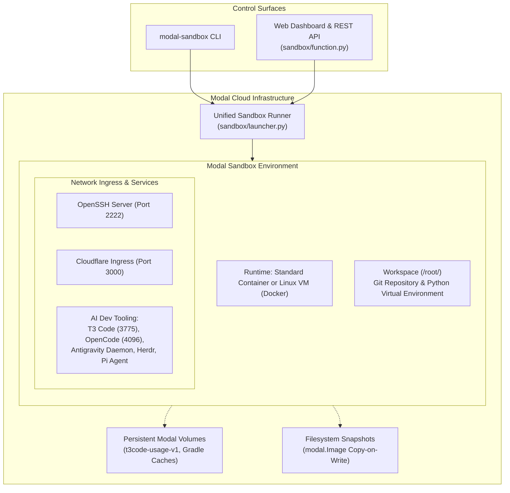

# Modal Sandboxes & Software Factory

Toolkit for provisioning, managing, and snapshotting isolated cloud execution environments on [Modal](https://modal.com) with OpenSSH, Cloudflare Tunnel ingress, and integrated AI developer tooling.

---

## Architecture Overview

---

## Key Capabilities

- **Zero-Config Standalone Sandboxes**: Launch disposable cloud development instances in seconds with `modal-sandbox --name <sandbox-name>`, requiring only a standard Modal account.
- **Dual Runtimes**: Choose between lightweight standard container sandboxes and full Linux VM sandboxes (`--vm`) equipped with Docker-in-Docker and custom kernel privileges.
- **Hermetic Ingress**: Automatic Cloudflare Tunnel provisioned on port 3000 alongside OpenSSH on port 2222 with zero-friction SSH config registration (`ssh <sandbox-name>`).
- **Filesystem Snapshotting**: Instant copy-on-write image capture (`modal-sandbox --snapshot <id>`) and resumption (`modal-sandbox --from-snapshot <image-id>`).
- **Integrated AI Developer Tooling**: Turnkey provisioning for T3 Code, Antigravity ACP, OpenCode Go, Pi Agent, Herdr, and Playwright-ready headless Chrome.
- **Serverless Web Control Plane**: Deploy a lightweight FastAPI control plane on Modal (`modal deploy sandbox/function.py`) providing a unified web dashboard and REST API.

---

## Quick Navigation

-   :material-rocket-launch:{ .lg .middle } __[Getting Started](getting-started/quickstart.md)__

    ---

    Launch your first sandbox in under 60 seconds with no credentials beyond `modal setup`.

    [:octicons-arrow-right-24: Start Quickstart](getting-started/quickstart.md)

-   :material-console:{ .lg .middle } __[CLI Reference](guides/cli.md)__

    ---

    Explore all command-line options, feature flags, runtime configurations, and snapshot actions.

    [:octicons-arrow-right-24: View CLI Guide](guides/cli.md)

-   :material-layers-outline:{ .lg .middle } __[Core Architecture](architecture/overview.md)__

    ---

    Understand the unified runner, dual execution runtimes, network ingress, and secret lifecycle.

    [:octicons-arrow-right-24: Explore Architecture](architecture/overview.md)

-   :material-robot-outline:{ .lg .middle } __[AI Developer Tooling](guides/ai-tooling.md)__

    ---

    Connect T3 Code, Antigravity, OpenCode, and Pi Coding Agent to live sandboxes.

    [:octicons-arrow-right-24: Configure AI Tools](guides/ai-tooling.md)

-   :material-view-dashboard-outline:{ .lg .middle } __[Control Plane & Dashboard](guides/control-plane.md)__

    ---

    Operate the serverless web management dashboard and REST APIs across all Modal apps.

    [:octicons-arrow-right-24: Inspect Dashboard](guides/control-plane.md)

-   :material-file-document-multiple-outline:{ .lg .middle } __[ADRs](adr/index.md)__

    ---

    Browse the collection of 93+ Architecture Decision Records documenting design choices.

    [:octicons-arrow-right-24: Read ADRs](adr/index.md)

