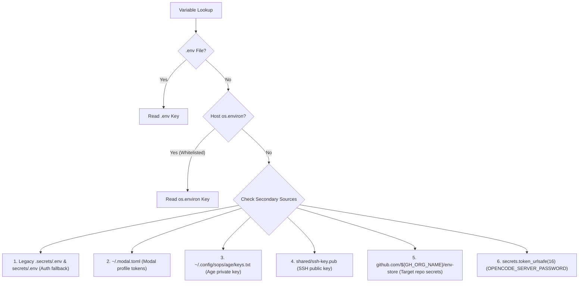

# Environment Variables Reference

Modal Sandboxes uses a unified `.env` file for local development and control plane operations (templated in [`.env.example`](https://github.com/sFactory0/software-factory/blob/main/.env.example)).

## Configuration Variables

### 1. Control Plane & Dashboard Authentication
- `WEB_UI_USERNAME`: Username for HTTP Basic Authentication on the web dashboard and REST API routes (`POST /launch`, `POST /snapshot`) (default: `admin`).
- `WEB_UI_PASSWORD`: Password for HTTP Basic Authentication on the web dashboard and REST API routes (`POST /launch`, `POST /snapshot`).

### 2. Modal Cloud Authentication
- `MODAL_TOKENS`: JSON array string containing multi-account Modal profile objects with credentials (`token_id`, `token_secret`, optional `active`).

### 3. Source Control & GitHub
- `GH_TOKEN`: GitHub Personal Access Token with repository read/clone permissions.
- `GH_ORG_NAME`: Default GitHub organization name (e.g., `sFactory0`). When passing shorthand `-r <repo>`, the runner clones `https://github.com/${GH_ORG_NAME}/${repo}`.

### 4. Remote Ingress & SSH
- `CLOUDFLARE_TUNNEL_TOKEN`: Cloudflare Tunnel credential token for custom ingress domains.
- `MODAL_SANDBOX_TUNNEL_DOMAIN`: Optional custom hostname display format (e.g. `3000.yourdomain.com`).
- `SSH_AUTHORIZED_KEY`: Optional explicit SSH public key string to authorize in addition to `shared/ssh-key.pub`.

### 5. AI Tooling Providers
- `OPENCODE_GO_API_KEY`: API key for OpenCode Go provider.
- `ANTIGRAVITY_CLIENT_ID`: OAuth client ID for Google Antigravity.
- `ANTIGRAVITY_CLIENT_SECRET`: OAuth client secret for Google Antigravity.
- `ANTIGRAVITY_TOKENS`: JSON array string containing Antigravity user profile credentials.

### 6. Encryption & SOPS
- `AGE_PRIVATE_KEY`: Age private key (`AGE-SECRET-KEY-...`) used by SOPS to decrypt repository environment secrets.

### 7. Software Factory Provenance (In-Sandbox & Control Plane)
- `SOFTWARE_FACTORY_COMMIT`: Full 40-character Git commit SHA of the `software-factory` checkout from which the sandbox was created.
- `SOFTWARE_FACTORY_COMMIT_SHORT`: 7-character short commit SHA.
- `SOFTWARE_FACTORY_REF`: Git branch or tag name of the `software-factory` checkout (e.g. `main`).
- `SOFTWARE_FACTORY_DIRTY`: Boolean indicator (`"1"` or `"0"`) signaling whether the host checkout had uncommitted modifications at the time of sandbox creation.

---

## Resolution Order & Precedence

Modal Sandboxes resolves environment variables through a deterministic cascade across configuration files, host environment variables, and remote secret vaults.

### 1. Host Environment Whitelist

When bundling secrets for Modal injection (`sandbox/function.py` and `sandbox/launcher.py`), the runner does **not** forward the host's entire `os.environ`. Instead, it samples only an explicit whitelist:

`WEB_UI_USERNAME`, `WEB_UI_PASSWORD`, `GH_TOKEN`, `GH_ORG_NAME`, `CLOUDFLARE_TUNNEL_TOKEN`, `MODAL_SANDBOX_TUNNEL_DOMAIN`, `SSH_AUTHORIZED_KEY`, `OPENCODE_GO_API_KEY`, `ANTIGRAVITY_CLIENT_ID`, `ANTIGRAVITY_CLIENT_SECRET`, `ANTIGRAVITY_TOKENS`, `AGE_PRIVATE_KEY`, `MODAL_TOKENS`, `TURSO_DATABASE_URL`, `TURSO_AUTH_TOKEN`.

> **Why a whitelist?** Sweeping the entire host environment would bundle sensitive host credentials (such as AWS keys, personal API tokens, SSH agent variables, or shell history) and leak them into remote container environments.

### 2. Precedence Rules: `.env` vs. Host `os.environ`

The conflict resolution order depends on the functional role of the credential:

| Credential Type | Precedence Rule | Rationale |
| :--- | :--- | :--- |
| **Control Plane Auth** (`WEB_UI_USERNAME`, `WEB_UI_PASSWORD`) | **Host `os.environ` WINS over `.env`** | Allows operators to supply ad-hoc credentials via CLI or CI/CD pipelines without modifying tracked local files. |
| **Tooling & Service Secrets** (`GH_TOKEN`, `AGE_PRIVATE_KEY`, etc.) | **`.env` file WINS over Host `os.environ`** | Guarantees reproducible local runs from the verified project `.env` file, using host environment variables solely as fallbacks for missing keys. |
| **Child Sandbox Launching** (`sandbox/launcher.py`) | **`.env` file used exclusively if present** | If `.env` exists on the local machine, `modal.Secret.from_dotenv(".env")` bundles it directly. In container or CI environments lacking `.env`, it falls back to the whitelisted keys in `os.environ`. |

### 3. Multi-Source Lookup Hierarchy

If a configuration value is not resolved in the primary `.env` file or host environment, the runner consults secondary sources:

1. **Legacy Directory Fallback Files**:
   - `root / ".secrets" / ".env"` and `root / "secrets" / ".env"` are checked if `WEB_UI_USERNAME` or `WEB_UI_PASSWORD` are absent from root `.env`.
2. **User Configuration Files**:
   - `~/.modal.toml` (or `$MODAL_CONFIG_PATH`): Parsed by `sandbox/profiles.py` for Modal account workspace profiles.
   - `~/.config/sops/age/keys.txt`: Parsed by `sandbox/env_store.py` for SOPS Age private keys if not provided via `AGE_PRIVATE_KEY`.
   - `shared/ssh-key.pub`: Read by `sandbox/launcher.py` if `SSH_AUTHORIZED_KEY` is not explicitly set.
3. **Remote Secret Vault (`env-store`)**:
   - For repository sandboxes (`-r <repo>`), target repository environment configurations are fetched directly from the private `github.com/${GH_ORG_NAME}/env-store` repository using `GH_TOKEN` and decrypted host-side.
4. **Dynamic Runtime Generation**:
   - Ephemeral passwords like `OPENCODE_SERVER_PASSWORD` are generated cryptographically at launch using `secrets.token_urlsafe(16)` and injected directly into the target sandbox.
