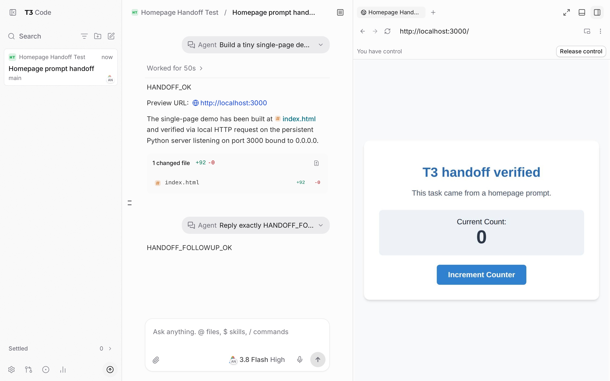

# Homepage prompt → T3 web chat: live verification

Verified 2026-11-26 against T3 **v0.1.11** using the factory CLI and the current sandbox's T3 browser. This was an ephemeral integration experiment; no launcher/frontend implementation was added.

## Result

The proposed handoff works. A factory-launched sandbox accepted project registration and an initial prompt through T3's CLI. Antigravity built a tiny app. Opening that sandbox's T3 web UI in our current T3 browser displayed the conversation and running application side by side.

Direct authentication into the intended chat also worked in a fresh incognito profile. A separate pairing screen/redirect change is unnecessary for the tested T3 version.



## Environment and isolation

- Factory baseline: `0276323`; SDK: Modal 1.6.4.
- Sandbox: `sb-01M8AY6MWQCJK0J8GTPV8S9RBZ`, under `test-software-factory`.
- Target clone: `${GH_ORG_NAME}/software-factory`, using `--testing`.
- Dedicated demo workspace: `/root/handoff-demo`; no application code was changed in the factory checkout.
- Shared T3 conversation persistence and Cloudflare application ingress were disabled. T3 used its own Modal HTTPS tunnel.
- Existing Antigravity credentials were used. No additional login was required.
- The sandbox was terminated after verification. A subsequent `poll()` returned exit code **137**, confirming it had stopped. Both test browser tabs were closed; the screenshot above preserves the result.

## Commands exercised

The actual launch used the user's requested alias:

```bash
modal-sandbox --testing --repo software-factory --t3code \
  --no-t3-persist --no-cloudflare --no-ssh-config
```

After the factory returned the sandbox ID and T3 endpoint, commands were executed inside that sandbox using `modal.Sandbox.exec`. The project directory was created and initialized with Git first.

```bash
t3 project add /root/handoff-demo \
  --base-dir /root/.t3 --title 'Homepage Handoff Test'

t3 thread start /root/handoff-demo - \
  --base-dir /root/.t3 \
  --provider antigravity --model gemini-3.8-flash \
  --title 'Homepage prompt handoff' --json

t3 thread list --project /root/handoff-demo \
  --base-dir /root/.t3 --json

t3 thread show '<thread-id>' --base-dir /root/.t3 --json

t3 thread send '<thread-id>' \
  'Reply exactly HANDOFF_FOLLOWUP_OK. Do not change any files or stop the demo server.' \
  --base-dir /root/.t3 --json

t3 auth pairing create --base-dir /root/.t3 \
  --ttl 5m --label 'Direct thread navigation verification' --json
```

`thread start` read the original prompt through stdin. With Modal's process stream, the working sequence was `stdin.write(prompt)`, `stdin.write_eof()`, then `stdin.drain()`. No `--wait` was used: CLI submission returned the thread/project/run IDs while the agent worked.

The first prompt requested a plain HTML/CSS/JS page with the heading “T3 handoff verified,” a counter button, and a persistent Python HTTP server on `0.0.0.0:3000`. Antigravity created `index.html`, started the server, and replied `HANDOFF_OK`. An independent HTTP request from inside the sandbox returned **200** and confirmed the expected heading and button markup. A follow-up CLI message received `HANDOFF_FOLLOWUP_OK` in the same conversation. The final thread state was `completed` with two runs and Antigravity `gemini-3.8-flash`.

The app was opened through T3's detected `localhost:3000` server entry, producing the adjacent browser panel shown above. The screenshot verifies rendering beside chat; the counter interaction was not established by this experiment.

## Authentication and navigation observations

1. **Existing factory pairing URL:** opening `/pair#token=...` in the current T3 browser automatically paired successfully, but the resulting UI opened a fresh draft. It did not select the CLI-created conversation.
2. **Chat route after pairing:** navigating to `/<environmentId>/<encodedThreadId>` opened the created conversation, its original prompt, and Antigravity's result.
3. **Single-navigation handoff:** minting a new token and opening `/<environmentId>/<encodedThreadId>#token=<token>` in the browser's **incognito** profile authenticated and stayed on that exact chat route. T3 removed the fragment from the address.
4. **Reload:** navigating again to the same chat URL without a token preserved the authenticated session and displayed the follow-up response.

The environment ID was read from `/root/.t3/userdata/environment-id`; thread/project/run IDs came from `thread start --json`. The observed thread ID contained `:`, so it was percent-encoded as a path segment.

One-time credentials are intentionally omitted from this note. The prompt belongs in the submission body/stdin, not the redirect URL.

## Corrections and integration details

- **No redirect patch required:** the earlier concern about `/pair` returning to home was real for that route, but unnecessary to solve when the token is attached to the direct chat URL.
- **Select an authenticated provider:** the new sandbox's Codex credential profile was unsigned-in. Antigravity was authenticated and completed both requests.
- **Discover model IDs:** `gemini-3.8-flash-low`, present in factory startup settings for text generation/source-control writing, was rejected by `thread start`. The advertised model `gemini-3.8-flash` worked. Choose supported model options separately rather than inventing model suffixes.
- **Message attribution differs:** CLI-created threads report `createdBy: agent` and `creationSource: mcp`; the web UI marks submitted prompts as **Agent**. The content is correctly preserved, but exact user-authored attribution is not established. This is a presentation decision for the launcher.
- **Use the sandbox's own CLI/server state:** `--base-dir /root/.t3` addressed the new sandbox, not the parent conversation or parent T3 server.
- **Supported command details matter:** `thread list` takes `--project <path>`, unlike `thread start`, which takes the project as a positional argument.
- **Scope of proof:** one successful new-sandbox flow, one follow-up, ordinary pairing, direct token navigation, and a reload. This does not verify mobile clients, multiple unrelated users, server restarts, retries, or persistence after sandbox replacement.

## Revised launcher plan

1. Save a build request with a stable ID, original prompt, and owning user/project before provisioning.
2. Launch/reuse the intended T3-enabled sandbox and wait for actual T3 readiness.
3. Scaffold/register the app workspace; choose an authenticated provider and advertised model.
4. Submit the initial prompt through the sandbox's T3 CLI; persist sandbox/project/environment/thread/run IDs. Reconcile uncertain submissions before retrying so a lost response cannot create duplicate runs.
5. Mint a short-lived one-time token, construct the direct sandbox chat URL with that token as a fragment, and navigate the user's browser there.
6. Keep subsequent interaction in T3; instruct the agent to start the app and open its local URL in T3's preview. In the experiment, opening the detected server entry was manual.
7. Store the token-free chat URL for “Open project” and regression-test direct token navigation whenever the pinned T3 version changes.

The remaining feature is the homepage and durable launch coordinator around these verified operations. The demo did not implement that coordinator, automatic app-preview opening, or public-user identity/isolation.

## Local implementation references

- [Factory CLI](https://github.com/sFactory0/software-factory/blob/0276323238d801ca4443f75a79e4a239438d2475/sandboxes/sandbox/main.py) and [launch models](https://github.com/sFactory0/software-factory/blob/0276323238d801ca4443f75a79e4a239438d2475/sandboxes/sandbox/core.py).
- [T3 setup/pairing](https://github.com/sFactory0/software-factory/blob/0276323238d801ca4443f75a79e4a239438d2475/sandboxes/sandbox/t3.py) and [sandbox startup](https://github.com/sFactory0/software-factory/blob/0276323238d801ca4443f75a79e4a239438d2475/sandboxes/shared/startup.sh).
- [Application scaffolder](https://github.com/sFactory0/software-factory/blob/0276323238d801ca4443f75a79e4a239438d2475/sandboxes/sandbox/app_scaffolder/_template.py).
- [Revised gap analysis](lovable-gap-analysis.md).

The CLI help/output, browser observations, and saved screenshot are the primary evidence for this experiment; no unsupported HTTP orchestration API was assumed.
