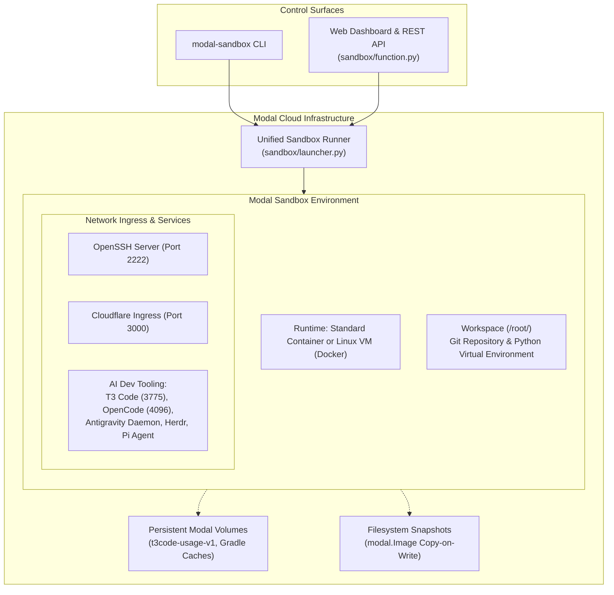

# Modal Sandboxes

Toolkit for provisioning, managing, and snapshotting isolated cloud execution environments on Modal with SSH, Cloudflare Tunnel ingress, and integrated AI developer tooling.

---

## Architecture Overview



---

## 1. Quickstart (Zero-Config in 60s)

Launch a clean standalone cloud development sandbox with zero external configuration beyond the standard Modal CLI:

```bash
# 1. Clone repository and install in editable mode
git clone https://github.com/<org>/modal-sandboxes.git
cd modal-sandboxes
python3 -m venv .venv
source .venv/bin/activate
pip install -e .

# 2. Authenticate with Modal (one-time setup)
modal setup

# 3. Launch your first standalone sandbox
modal-sandbox --name my-first-sandbox
```

Upon launch, `modal-sandbox` provisions the environment, configures OpenSSH keys, injects SSH configuration into your `~/.ssh/config`, and launches a Cloudflare web ingress tunnel on port 3000.

Connect immediately via SSH:

```bash
ssh my-first-sandbox
# Or open an interactive shell via Modal CLI:
modal shell <sandbox-id>
```

---

## 2. Feature & Credential Tiers

Configure credentials via `.env` (copy from [`.env.example`](.env.example)) only when opting into advanced integrations:

| Feature Tier | CLI Flag | Required Credentials (`.env`) | What It Provides |
| :--- | :--- | :--- | :--- |
| **Standalone Sandbox** | `--name <name>` | None (`modal setup` only) | Clean, isolated workspace with SSH, bash, Git, and Python virtual environment. |
| **Target Repository** | `-r <repo>` | `GH_TOKEN`, `GH_ORG_NAME` | Clones target GitHub repository directly into `/root/<repo>` on launch. |
| **Web Ingress (Port 3000)** | Default | None (optional `MODAL_SANDBOX_TUNNEL_DOMAIN`) | Pre-configured Cloudflare Tunnel on port 3000. Disable via `--no-cloudflare`. |
| **Linux VM Sandbox** | `--vm` | None | Full virtualization with custom kernel privileges, Docker daemon, and swapfile. |
| **T3 Code Server** | `--t3` | None | Background agent harness with encrypted web pairing URL and ASCII QR code. |
| **Antigravity CLI** | `--agy` | `ANTIGRAVITY_TOKENS` | Google Gemini agent CLI and Antigravity Remote Control background daemon. |
| **OpenCode Server** | `--opencode` | `OPENCODE_GO_API_KEY` | OpenCode web interface on port 4096 with one-time password and HTTPS tunnel. |
| **Pi Coding Agent** | `--pi` | None | Lightweight terminal coding agent CLI pre-installed in user path. |
| **Herdr Multiplexer** | `--herdr` | None | Terminal multiplexer and process coordinator pre-installed in `/usr/local/bin`. |
| **React Native / Android** | `--react-native` | None | Android SDK/NDK, OpenJDK 17, Watchman, and Metro bundler tunnel (port 8081). |
| **Headless Chrome** | `--browser` | None | Pre-baked Google Chrome for Playwright, Puppeteer, and Chrome DevTools MCP servers. |
| **Modal Inside Sandbox** | `--modal` | Optional (`MODAL_TOKEN_ID`, `MODAL_TOKEN_SECRET`) | Virtual environment pre-installed with Modal SDK for developing Modal apps inside sandboxes. |

---

## 3. CLI Usage (`modal-sandbox`)

The **Modal Sandbox CLI** provides full control over container and VM provisioning:

```bash
# Standalone development box:
modal-sandbox --name dev-box

# Repository sandbox with shallow clone:
modal-sandbox -r my-repo

# Full clone with complete git history on custom branch:
modal-sandbox -r my-repo -b feature-branch --full-clone

# Full Linux VM with Docker daemon:
modal-sandbox -r my-repo --vm

# Sandbox with complete AI developer tooling:
modal-sandbox -r my-repo --t3 --agy --herdr --browser
```

### CLI Options Reference

| Flag | Description | Default |
| :--- | :--- | :--- |
| `-n, --name` | Instance and Modal App name (required for standalone runs) | None |
| `-r, --repo` | Target GitHub repository (`<owner>/<repo>` or shorthand `<repo>`) | None |
| `-b, --github-branch` | Git branch to checkout | `main` |
| `--full-clone` | Fetch complete commit history (default is shallow depth 50) | `False` |
| `--vm` | Provision a Linux VM Sandbox with Docker daemon instead of standard container | `False` |
| `--memory <GB>` | (Deprecated) Configures swapfile allocation (2 × N GB) for VM sandboxes | `1` |
| `--testing` | Target repository with `test-` prefix in default organization | `False` |
| `--t3` | Launch T3 Code server with pairing token and web tunnel | `False` |
| `--agy` | Enable Antigravity CLI and Remote Control daemon | `False` |
| `--opencode` | Launch OpenCode server on port 4096 with web tunnel | `False` |
| `--pi` | Install Pi Coding Agent CLI | `False` |
| `--herdr` | Install Herdr agent multiplexer | `False` |
| `--browser` | Pre-bake headless Google Chrome for browser MCP tooling | `False` |
| `--react-native` | Install Android SDK/NDK toolchain and Metro tunnel | `False` |
| `--modal` | Provision Modal SDK and client credentials inside sandbox | `False` |
| `--no-cloudflare` | Disable default Cloudflare Tunnel ingress on port 3000 | `False` |
| `--no-ssh-config` | Do not automatically append SSH connection details to `~/.ssh/config` | `False` |
| `--sops` | Retain Age private key in `~/.config/sops` for debugging | `False` |
| `--remote` | Delegate sandbox execution to the hosted Modal control plane function | `False` |

---

## 4. Filesystem Snapshots

Capture copy-on-write root filesystem images of running sandboxes for near-instant cold starts:

```bash
# Capture snapshot from an active sandbox (retains for 30 days by default):
modal-sandbox --snapshot <sandbox-id> [--snapshot-ttl 30] [--terminate]

# Resume/launch directly from a snapshot image:
modal-sandbox --from-snapshot <image-id> --name resumed-app [--vm]
```

---

## 5. Access & Ingress

- **SSH**: Uses tracked public key [`shared/ssh-key.pub`](shared/ssh-key.pub) (overridable via `SSH_AUTHORIZED_KEY` in `.env`) and private key `~/.ssh/modal-sandbox`. On launch, connection details are automatically appended to `~/.ssh/config` (skip with `--no-ssh-config`):
  ```bash
  ssh <instance_name>
  # Or with explicit port/key:
  ssh -i ~/.ssh/modal-sandbox -p <port> root@<host>
  # Or via Modal CLI:
  modal shell <sandbox-id>
  ```
- **Web Ingress (Port 3000)**: Pre-configured Cloudflare Tunnel routes external HTTPS traffic (customizable via `MODAL_SANDBOX_TUNNEL_DOMAIN`) to container `localhost:3000`.
- **T3 Code Server**: Pairing URL and ASCII QR code printed on launch when `--t3` is passed.
- **OpenCode (Port 4096)**: HTTPS tunnel URL and one-time password printed on launch when `--opencode` is passed.

---

## 6. Hosted Control Plane & Web Dashboard

The control plane can run serverlessly in the cloud on Modal:

```bash
# Deploy control plane to Modal Cloud (requires WEB_UI_USERNAME and WEB_UI_PASSWORD in .env):
modal deploy sandbox/function.py

# Interactive local development serve mode:
modal serve sandbox/function.py
```

- **Web Dashboard**: Access `GET /` with HTTP Basic Authentication (`WEB_UI_USERNAME` / `WEB_UI_PASSWORD`) to inspect active sandboxes across workspace profiles, launch fresh repository or standalone sandboxes, capture snapshots, and resume from snapshot images.
- **Web REST API**: Authenticated via HTTP Basic Authentication (`POST /api/sandboxes`, `POST /api/snapshots/{image_id}/launch`, `POST /api/sandboxes/{sandbox_id}/terminate`, `POST /api/sandboxes/{sandbox_id}/snapshot`).
- **Headless API**: Access `POST /launch` and `POST /snapshot` with Bearer token authentication (`MODAL_SANDBOX_AUTH_TOKEN`).

---

## 7. Verification & Automated Tests

All automated tests run hermetically:

```bash
# Verify repository standards and Universal File Line Budget (<= 500 lines):
pytest tests/test_standards.py

# Run complete hermetic test suite:
pytest
```

---

## 8. Contributing & Community

We welcome contributions! Please review our community guides before submitting pull requests:

- [Contributing Guide](CONTRIBUTING.md)
- [Code of Conduct](CODE_OF_CONDUCT.md)
- [Security Policy](SECURITY.md)
- [Architecture Decision Records (ADRs)](docs/adr/)
