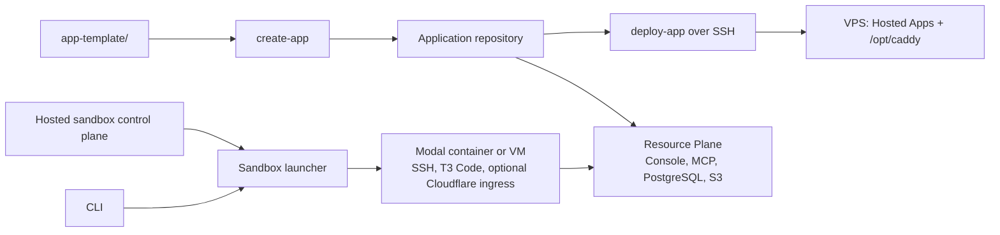

# Software Factory

Provision Modal development sandboxes, manage persistent PostgreSQL and S3 resources, and scaffold applications from a shared starter template.

| Subsystem | Purpose |
| :--- | :--- |
| `sandboxes/` | Python CLI, hosted sandbox control plane, images, snapshots, and deployment tools |
| `resource-plane/` | Next.js 16 / React 19 console and MCP API, PostgreSQL 16, and SeaweedFS S3 |
| `app-template/` | Next.js 16 starter with optional Expo mobile client, database, authentication, and agent skills |

## Architecture



## Install

Use Python 3.11+ on Linux, macOS, or WSL2, with Git and OpenSSH installed:

```bash
git clone https://github.com/sFactory0/software-factory.git
cd software-factory
python3 -m venv .venv
source .venv/bin/activate
python -m pip install -r requirements.txt
modal setup
```

`requirements.txt` installs the package with `dev` and `docs` extras, including pytest and Zensical. For just the runtime CLI, use `python -m pip install -e .`.

## Launch a sandbox

```bash
# Standalone workspace, without Cloudflare ingress
modal-sandbox --name dev-box --no-cloudflare

# Repository workspace with T3 Code (also enables browser tooling)
modal-sandbox --repo my-org/my-repo --t3

# VM with Docker, or an interactive XFCE desktop
modal-sandbox --name vm-box --vm --no-cloudflare
modal-sandbox --name desktop-box --xfce
```

Repository launches require `GH_TOKEN`; shorthand repository names also require `GH_ORG_NAME`. Copy [`.env.example`](.env.example) to `.env` when configuring integrations.

The launcher reads [`sandboxes/shared/ssh-key.pub`](sandboxes/shared/ssh-key.pub). SSH requires the matching private key at `~/.ssh/modal-sandbox`. It does not generate a client key pair for you. To use a different pair, update the public-key file on the launch host; redeploy the hosted control plane after changing its files. You can also use `modal shell <sandbox-id>` with your authenticated Modal client.

Each launch creates an instance such as `dev-box-a1b2c3d4`. Use the **printed SSH alias**, including the generated suffix, rather than the requested app name. The standalone workspace is `/root/<instance-name>`; repository workspaces use `/root/<repo>`.

Cloudflare application ingress requires `CLOUDFLARE_TUNNEL_TOKEN` and a tunnel route configured for port 3000. Without a token, startup skips the tunnel. `MODAL_SANDBOX_TUNNEL_DOMAIN` controls the displayed hostname; it does not provision DNS or a tunnel. T3 Code has a separate Modal HTTPS endpoint.

See [setup](docs/getting-started/prerequisites.md), [quickstart](docs/getting-started/quickstart.md), and the [CLI reference](docs/guides/cli.md).

## Snapshots

```bash
modal-sandbox --snapshot <sandbox-id> --snapshot-ttl 30 --terminate
modal-sandbox --from-snapshot <image-id> --name resumed-box
```

Snapshots preserve files, including any credentials written to the filesystem. Treat them as sensitive. Resumption skips repository cloning and package installation, so an older snapshot does not automatically acquire new dependencies. See [snapshots](docs/architecture/snapshots.md) and [secrets](docs/architecture/secrets.md).

## Hosted sandbox control plane

Set `WEB_UI_USERNAME` and `WEB_UI_PASSWORD` in the factory environment, then deploy from a clean checkout:

```bash
modal deploy sandboxes/sandbox/function.py
```

The dashboard can launch, list, terminate, snapshot, and resume sandboxes across configured profiles. The CLI can use it through `--remote --endpoint-url <url>`. See the [control plane guide](docs/guides/control-plane.md).

## Persistence and applications

Run VPS deployment commands from the host with its explicit `RESOURCE_PLANE_SSH_KEY`:

```bash
modal-sandbox infra deploy --check-only
modal-sandbox infra deploy
modal-sandbox infra caddy --bootstrap --domain resources.example.com

create-db app-db --write-env
create-s3 app-assets --write-env
create-app my-app --cloud
```

Use [Resource Plane deployment](docs/guides/resource-plane-deployment.md) for SSH, local development, Caddy, and backups. Use [application creation and deployment](docs/guides/applications.md) for template options, cloud prerequisites, wildcard HTTPS, redeployment, and teardown.

Other installed commands include `deploy-infra`, `setup-caddy`, `push-repo-env`, `pull-repo-env`, and `deploy-app`. The [CLI reference](docs/guides/cli.md) describes their options.

## Verification and documentation

```bash
pytest
zensical build --strict
zensical serve
```

For a fresh Software Factory repository sandbox with Modal tooling enabled, startup installs `requirements.txt`, including documentation dependencies. `--modal` requires valid `MODAL_TOKENS`. Existing or resumed sandboxes can install the current requirements manually.

The [documentation homepage](docs/index.md) links the guides and architecture references. [Contributing](CONTRIBUTING.md), [security policy](SECURITY.md), [code of conduct](CODE_OF_CONDUCT.md), and [ADRs](docs/adr/index.md) describe project practices and decision history.
