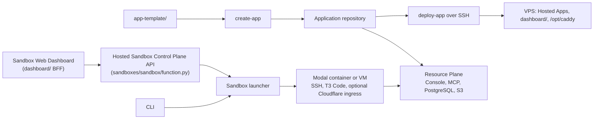

# Software Factory

Provision Modal development sandboxes, manage persistent PostgreSQL and S3 resources, and scaffold applications from a shared starter template.

| Subsystem | Purpose |
| :--- | :--- |
| `sandboxes/` | Python CLI, Hosted Sandbox Control Plane built with FastAPI, images, snapshots, and deployment tools |
| [`dashboard/`](dashboard/README.md) | Next.js 16 / React 19 Sandbox Web Dashboard and same-origin BFF proxy fronting the Hosted Sandbox Control Plane |
| [`resource-plane/`](resource-plane/README.md) | Resource Plane Console and Resource Plane Management API, PostgreSQL 16, and SeaweedFS S3 |
| [`app-template/`](app-template/README.md) | Next.js 16 starter with optional Expo mobile client, database, authentication, and agent skills |

## Architecture



## Install

Use **Python 3.11+**, **Git**, and **OpenSSH** on Linux, macOS, or WSL2, with an authenticated [Modal](https://modal.com) account:

```bash
git clone https://github.com/YoungMahesh/software-factory.git
cd software-factory
python3 -m venv .venv
source .venv/bin/activate
python -m pip install -r requirements.txt
modal setup
modal-sandbox --help
```

`requirements.txt` installs the package with `dev` and `docs` extras, including pytest and Zensical. For just the runtime CLI, use `python -m pip install -e .`.

If you plan to run `create-app`, the Sandbox Web Dashboard (`dashboard/`), or the Resource Plane (`resource-plane/`) locally, also install **Node.js 20+** and **pnpm 10.31.0**, then install workspace dependencies from the repository root:

```bash
pnpm install
```

## Launch a sandbox

```bash
# Standalone workspace, without Cloudflare ingress
modal-sandbox --name dev-box --no-cloudflare

# Repository workspace with T3 Code (also enables headless browser tooling)
modal-sandbox --repo my-org/my-repo --t3

# VM with Docker, or an interactive XFCE desktop
modal-sandbox --name vm-box --vm --no-cloudflare
modal-sandbox --name desktop-box --xfce
```

Standalone launches (`--name`) require only `modal setup`. Repository launches (`--repo`) require `GH_TOKEN`; shorthand repository names also require `GH_ORG_NAME`. Copy [`.env.example`](.env.example) to `.env` when configuring integrations.

The launcher authorizes the public key in [`sandboxes/shared/ssh-key.pub`](sandboxes/shared/ssh-key.pub) and configures SSH to look for `~/.ssh/modal-sandbox`. The repository ships the maintainer's public key only (no private key), so generate your own pair and update `sandboxes/shared/ssh-key.pub` before connecting over SSH (or use `modal shell <sandbox-id>` directly):

```bash
ssh-keygen -t ed25519 -f ~/.ssh/modal-sandbox
cp ~/.ssh/modal-sandbox.pub sandboxes/shared/ssh-key.pub
chmod 600 ~/.ssh/modal-sandbox
```

Redeploy the Hosted Sandbox Control Plane after changing files on the launch host.

Each launch creates an instance such as `dev-box-a1b2c3d4`. Use the **printed SSH alias**, including the generated suffix, rather than the requested app name. Standalone workspaces live at `/root/<instance-name>`; repository workspaces use `/root/<repo>`.

Cloudflare application ingress requires `CLOUDFLARE_TUNNEL_TOKEN` and a tunnel route configured for port 3000. Without a token, startup skips the tunnel (use `ssh -N -L 3000:127.0.0.1:3000 <alias>` for local forwarding). `MODAL_SANDBOX_TUNNEL_DOMAIN` controls only the displayed hostname; it does not provision DNS or a tunnel. T3 Code has a separate Modal HTTPS endpoint.

See [setup](docs/getting-started/prerequisites.md), [quickstart](docs/getting-started/quickstart.md), and the [CLI reference](docs/guides/cli.md).

## Snapshots

```bash
modal-sandbox --snapshot <sandbox-id> --snapshot-ttl 30 --terminate
modal-sandbox --from-snapshot <image-id> --name resumed-box
```

Snapshots preserve files, including any credentials written to the filesystem. Treat them as sensitive. Resumption skips repository cloning and package installation, so an older snapshot does not automatically acquire new dependencies. See [snapshots](docs/architecture/snapshots.md) and [secrets](docs/architecture/secrets.md).

## Hosted Sandbox Control Plane

Set `WEB_UI_USERNAME` and `WEB_UI_PASSWORD` in `.env` (or the process environment) and deploy the Hosted Sandbox Control Plane backend from a clean checkout:

```bash
modal deploy sandboxes/sandbox/function.py
```

For local edits without committing first, run `ALLOW_DIRTY_DEPLOY=1 modal serve sandboxes/sandbox/function.py`. When `RESOURCE_PLANE_SSH_KEY` is configured in `.env`, `modal deploy` reads its key material into `RESOURCE_PLANE_SSH_PRIVATE_KEY` for Hosted Sandbox Control Plane-backed dashboard self-deploys.

You can run the Next.js Sandbox Web Dashboard (`dashboard/`) and standalone **Dashboard Deployer** (`dashboard-deployer/`) locally (set `SANDBOX_CONTROL_PLANE_URL`, `APPS_BASE_DOMAIN`, `WEB_UI_USERNAME`, and `WEB_UI_PASSWORD` in `.env` or the app's `.env`) or deploy both to the VPS once `RESOURCE_PLANE_SSH_HOST`, `RESOURCE_PLANE_SSH_KEY`, `APPS_BASE_DOMAIN`, and a Cloudflare DNS-01 token (`CLOUDFLARE_DNS_API_TOKEN` or `CLOUDFLARE_API_TOKEN`) are configured:

```bash
# Local dashboard development server
pnpm --dir dashboard dev

# Local Dashboard Deployer development server
pnpm --dir dashboard-deployer dev

# Build and deploy production Sandbox Web Dashboard to https://<APPS_BASE_DOMAIN>
modal-sandbox infra dashboard

# Build and deploy standalone Dashboard Deployer to https://deploy.<APPS_BASE_DOMAIN>
modal-sandbox infra deployer
```

The Next.js dashboard provides the Builder for launching Builder Workspaces (including Prime Sandbox reuse, Repository Catalog selection, and model selection), live sandbox inspection with accrued Modal costs and lifespan timers, snapshot management, and Scratchpad (`Ideas` and `Raw` notes). The standalone **Dashboard Deployer** (`https://deploy.<APPS_BASE_DOMAIN>`) provides independent **Deploy Sandbox Web Dashboard** (`https://<APPS_BASE_DOMAIN>`) and **Deploy Documentation Web App** (Cloudflare Pages at `https://docs.<APPS_BASE_DOMAIN>`) buttons backed by the Hosted Sandbox Control Plane cloning GitHub `main`. The CLI can also use the backend through `--remote --endpoint-url <url>`. See the [Hosted Sandbox Control Plane guide](docs/guides/control-plane.md), [documentation deployment guide](docs/guides/deploying-documentation.md), [dashboard README](dashboard/README.md), and [Dashboard Deployer README](dashboard-deployer/README.md).

A Builder Workspace is a development workspace with its own coding conversation. Multiple Builder Workspaces can use the same Target Repository and share a Prime Sandbox; Hosted Apps have independent deployment lifecycles. The [glossary](GLOSSARY.md) defines these concepts.

## Persistence and applications

Scaffold a new Next.js (and optional Expo) application locally with zero cloud prerequisites:

```bash
create-app my-app -y
```

To provision persistent PostgreSQL 16 and SeaweedFS S3 on a Linux VPS with Docker and wire cloud apps, configure `.env` with `RESOURCE_PLANE_SSH_HOST` and an explicit `RESOURCE_PLANE_SSH_KEY` (canonically `.secrets/resource_plane_ssh`):

```bash
modal-sandbox infra deploy --check-only
modal-sandbox infra deploy
modal-sandbox infra caddy --bootstrap --domain resources.example.com

create-db app-db --write-env
create-s3 app-assets --write-env
create-app my-app --cloud
```

`create-app --cloud` requires `GH_TOKEN`, `GH_ORG_NAME`, configured Git authorship (`user.name`/`user.email`), a deployed Resource Plane, `sops` on the host, and a private `${GH_ORG_NAME}/config` repository for encrypted environment secrets.

Use [Resource Plane deployment](docs/guides/resource-plane-deployment.md) for SSH, local development, Caddy, and backups. Use [application creation and deployment](docs/guides/applications.md) for template options, cloud prerequisites, wildcard HTTPS, redeployment, and teardown.

Other installed commands include `push-repo-env`, `pull-repo-env`, and `deploy-app` alongside `modal-sandbox infra <deploy|dashboard|deployer|caddy>`. The [CLI reference](docs/guides/cli.md) describes their options.

## Verification and documentation

Ensure `.venv` is activated (`source .venv/bin/activate`) and `pnpm install` has been run at the repository root:

```bash
pytest
zensical build --strict
zensical serve
pnpm --dir dashboard test
pnpm --dir dashboard typecheck
pnpm --dir dashboard build
pnpm --dir dashboard-deployer test
pnpm --dir dashboard-deployer typecheck
pnpm --dir dashboard-deployer build
```

For a fresh Software Factory repository sandbox with Modal tooling enabled, startup installs `requirements.txt`, including documentation dependencies. `--modal` requires valid `MODAL_TOKENS`. Existing or resumed sandboxes can install the current requirements manually.

The [documentation homepage](docs/index.md) links the guides and architecture references. [Contributing](CONTRIBUTING.md), [security policy](SECURITY.md), [code of conduct](CODE_OF_CONDUCT.md), and [ADRs](docs/adr/index.md) describe project practices and decision history.
