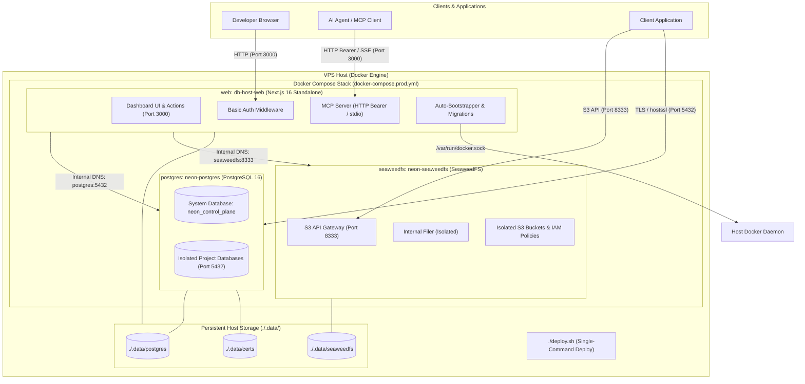

# DB Host Control Plane

A developer-focused local cloud console and MCP server for provisioning isolated PostgreSQL databases and S3-compatible object storages backed by Docker.

[](https://nextjs.org/)
[](https://react.dev/)
[](https://www.docker.com/)
[](https://www.postgresql.org/)
[](https://github.com/seaweedfs/seaweedfs)
[](https://pnpm.io/)

---

## Table of Contents

- [Overview](#overview)
- [Architecture](#architecture)
- [Key Concepts](#key-concepts)
- [Prerequisites](#prerequisites)
- [Local Development Quickstart](#local-development-quickstart)
- [Production Server Deployment](#production-server-deployment)
  - [Single-Command Quickstart](#single-command-quickstart)
  - [What Happens Automatically](#what-happens-automatically)
  - [VPS Host Considerations](#vps-host-considerations)
  - [Updating & In-Place Upgrades](#updating--in-place-upgrades)
  - [Useful Operational Commands](#useful-operational-commands)
- [Connecting Client Applications](#connecting-client-applications)
  - [PostgreSQL with TLS Verification](#postgresql-with-tls-verification)
  - [S3 Object Storage](#s3-object-storage)
- [MCP Server Setup for AI Agents](#mcp-server-setup-for-ai-agents)
- [Data Persistence & Backups](#data-persistence--backups)
- [Operations & Troubleshooting](#operations--troubleshooting)
- [License](#license)

---

## Overview

**DB Host Control Plane** provides an on-premise, self-hosted developer platform akin to a lightweight Neon + Supabase Storage:
- **Logical Database Isolation**: Dynamically provisions isolated PostgreSQL databases with dedicated Resource Roles and strict ownership grants on a shared PostgreSQL 16 container.
- **S3 Object Storage**: Dynamically provisions isolated S3-compatible buckets with discrete IAM credentials on SeaweedFS.
- **Zero-Config Auto-Bootstrapper**: Communicates directly with the Docker daemon via `/var/run/docker.sock` to spin up, health-check, migrate, and maintain core service containers automatically.
- **In-Dashboard Tools**: Interactive SQL Scratchpad and S3 Object Browser directly inside the browser UI.
- **Built-in CA & TLS Encryption**: Generates an internal Root CA and server certificates on demand (`hostssl`) so external client applications can connect over untrusted networks securely.
- **MCP Server Suite**: 8 non-destructive Model Context Protocol tools accessible over stdio and HTTP/SSE for AI coding assistants.

---

## Architecture



---

## Key Concepts

Refer to [`GLOSSARY.md`](file:///root/.t3/worktrees/db-host/t3-2aa2bdaa/GLOSSARY.md) for canonical project terminology:

- **Project**: A logical grouping of associated PostgreSQL databases and S3 object storage buckets for an application.
- **Database**: A logically isolated database provisioned on the shared PostgreSQL container, assigned a unique user, password, and restricted permissions.
- **Object Storage**: An S3-compatible storage bucket provisioned on SeaweedFS, accompanied by dedicated access credentials.
- **Auto-Bootstrapper**: The background service that checks Docker state via `/var/run/docker.sock`, launches containers, applies Drizzle migrations to the System Database, and generates TLS certificates.
- **CA Certificate**: The internal Root Certificate Authority file (`/api/ca.crt`) downloaded by remote clients to verify the PostgreSQL server's TLS identity (`sslmode=verify-full`).
- **Control Plane Credentials**: HTTP Basic Auth credentials (`CONTROL_PLANE_USERNAME` & `CONTROL_PLANE_PASSWORD`) required to access the dashboard.
- **Master Database Credentials**: Superuser credentials (`POSTGRES_USER` & `POSTGRES_PASSWORD`) utilized by the Auto-Bootstrapper to provision databases and manage roles.
- **Storage Admin Credentials**: Root S3 credentials (`SEAWEEDFS_ADMIN_ACCESS_KEY` & `SEAWEEDFS_ADMIN_SECRET_KEY`) used to configure buckets and IAM policies.

---

## Prerequisites

- **Operating System**: Linux (Ubuntu 22.04 / 24.04 LTS or Debian 12 recommended)
- **Node.js**: `>= 20.0.0` (required only for local host development; production uses containerized Node.js)
- **pnpm**: `>= 10.0.0` (`npm install -g pnpm`)
- **Docker Engine**: Installed and running (Docker version `>= 24.0.0` with `docker compose` plugin)
- **OpenSSL**: Installed on host for cryptographic key and certificate generation

---

## Local Development Quickstart

1. **Clone the repository and install dependencies**:
   ```bash
   git clone <repo-url> db-host
   cd db-host
   pnpm install
   ```

2. **Configure environment**:
   ```bash
   cp .env.example .env.local
   ```
   *(In local development, missing credentials will be auto-generated with secure random values on startup and written to `.env.local`)*.

3. **Ensure Docker is running**:
   Make sure your local Docker daemon is running and `/var/run/docker.sock` is accessible.

4. **Start the development server**:
   ```bash
   pnpm dev
   ```
   The Auto-Bootstrapper will automatically:
   - Connect to Docker
   - Pull `postgres:16-alpine` and `chrislusf/seaweedfs:latest`
   - Start `neon-postgres` (port `127.0.0.1:5432`) and `neon-seaweedfs` (port `127.0.0.1:8333`)
   - Create the system database and apply Drizzle migrations
   - Generate local TLS certificates

5. **Open the Control Plane**:
   Navigate to [http://localhost:3000](http://localhost:3000) and sign in using the credentials displayed in your terminal (or defined in `.env.local`).

6. **Run tests**:
   ```bash
   pnpm test
   ```

---

## Production Server Deployment

Deploying DB Host Control Plane to a production server (VPS or cloud instance) with Docker pre-installed is executed with a **single automated command**.

No Node.js, pnpm, systemd, or reverse proxy configuration is required on the host. The entire stack (Control Plane Next.js web application, PostgreSQL 16 with enforced TLS encryption, and SeaweedFS S3 storage) is containerized and orchestrated via Docker Compose.

### Single-Command Quickstart

On your VPS host where Docker Engine is installed:

```bash
# 1. Clone the repository and enter the directory
git clone <repo-url> db-host
cd db-host

# 2. Run the single-command deployment
./deploy.sh
```

*(Alternatively, run `pnpm deploy:prod` if pnpm is installed).*

### What Happens Automatically

When you execute `./deploy.sh`:
1. **Docker Engine & Socket Check**: Validates that Docker and the `docker compose` plugin are running and accessible via `/var/run/docker.sock`.
2. **Production Secret Generation**: If `.env` does not exist, the script auto-generates cryptographically secure 32-byte tokens for master credentials (`POSTGRES_PASSWORD`, `CONTROL_PLANE_PASSWORD`, `ADMIN_TOKEN`, `SEAWEEDFS_ADMIN_SECRET_KEY`), creates `.env`, and sets secure file permissions (`chmod 600`).
3. **Pre-flight TLS & Storage Init**: Generates the internal Root CA certificate (`ca.crt`) and TLS server certificates (`server.crt`, `server.key`) with SANs matching your server host/IP, and writes SeaweedFS `s3.json` before containers boot.
4. **Multi-Stage Container Build & Launch**: Builds the lightweight standalone Next.js container and starts `web`, `postgres`, and `seaweedfs` in detached mode via `docker compose -f docker-compose.prod.yml up -d --build`.
5. **Automated Health Polling**: Polls `http://127.0.0.1:3000/api/health` until all services and database migrations are ready.
6. **Access Summary Banner**: Displays a formatted banner containing your Dashboard URL, credentials, PostgreSQL TLS connection string, and S3 endpoint.

### VPS Host Considerations

Since Docker Engine is already installed on your VPS, you only need to ensure the following host-level configurations:

#### 1. Docker Socket Permissions
Ensure the deploying user has permission to interact with Docker without `sudo`:
```bash
sudo usermod -aG docker $USER
# Apply group changes immediately:
newgrp docker
```

#### 2. Firewall & Port Security
Configure your firewall (`ufw` or cloud security groups) to expose only the required ingress points:
```bash
# Allow Control Plane Dashboard & HTTP MCP Endpoint
sudo ufw allow 3000/tcp

# Allow Remote PostgreSQL Client Connections (Enforced with TLS)
sudo ufw allow 5432/tcp

# Allow Remote SeaweedFS S3 Object Storage API
sudo ufw allow 8333/tcp

# IMPORTANT: Ensure SeaweedFS internal Filer port (8888) is NOT exposed to the public
sudo ufw deny 8888/tcp
```

#### 3. Persistent Storage
All PostgreSQL database files, SeaweedFS object chunks, and TLS certificates persist in the project's `./.data/` directory:
- `./.data/postgres/` — PostgreSQL data directory (system database + project databases)
- `./.data/seaweedfs/` — S3 bucket objects and filer state
- `./.data/certs/` — Root CA and server TLS certificates

This directory is preserved across container updates, rebuilds, and system reboots.

#### 4. Hardware Sizing Baseline
- **Minimum**: 2 GB RAM + 2 GB swap, 1 vCPU, 20 GB SSD.
- **Recommended**: 4 GB RAM, 2 vCPUs, 50 GB NVMe SSD for moderate multi-tenant workloads.

### Updating & In-Place Upgrades

To update to the latest version of DB Host Control Plane, simply pull the latest git commits and re-run `./deploy.sh`:

```bash
git pull && ./deploy.sh
```

`./deploy.sh` is completely idempotent:
- Reuses your existing credentials in `.env`.
- Preserves all databases and S3 files in `./.data`.
- Rebuilds modified Docker layers and recreates updated containers.
- Automatically applies any new Drizzle database migrations on boot.

### Useful Operational Commands

```bash
# View running production containers
docker compose -f docker-compose.prod.yml ps

# Follow web application logs
docker compose -f docker-compose.prod.yml logs -f web

# Follow PostgreSQL logs
docker compose -f docker-compose.prod.yml logs -f postgres

# Stop the entire production stack
docker compose -f docker-compose.prod.yml down

# Restart all services
docker compose -f docker-compose.prod.yml restart
```

---

## Connecting Client Applications

### PostgreSQL with TLS Verification

All remote client connections to PostgreSQL mandate TLS transport encryption (`hostssl`) as per [ADR 0020](file:///root/.t3/worktrees/db-host/t3-2aa2bdaa/docs/adr/0020-encryption-in-transit-for-remote-postgres.md).

1. **Download the CA Certificate**:
   ```bash
   curl -o ca.crt http://<server-ip>:3000/api/ca.crt
   ```
2. **Formulate the Connection String**:
   When a database is provisioned in a Project, DB Host generates a restricted Resource Role and Connection String:
   ```text
   postgresql://<role_name>:<password>@<server-ip>:5432/<database_name>?sslmode=verify-full&sslrootcert=ca.crt
   ```
3. **Connect via psql**:
   ```bash
   psql "postgresql://proj_user:secret@<server-ip>:5432/proj_db?sslmode=verify-full&sslrootcert=ca.crt"
   ```

### S3 Object Storage

Provisioned buckets include dedicated access keys restricted via Bucket IAM Policies:

- **Endpoint URL**: `http://<server-ip>:8333`
- **Region**: `us-east-1` (or default AWS SDK dummy region)
- **S3 Force Path Style**: `true`

Example AWS SDK for Node.js:
```typescript
import { S3Client, PutObjectCommand } from "@aws-sdk/client-s3";

const s3 = new S3Client({
  endpoint: "http://<server-ip>:8333",
  region: "us-east-1",
  credentials: {
    accessKeyId: process.env.STORAGE_ACCESS_KEY_ID!,
    secretAccessKey: process.env.STORAGE_SECRET_ACCESS_KEY!,
  },
  forcePathStyle: true,
});
```

---

## MCP Server Setup for AI Agents

DB Host exposes an 8-tool MCP suite for AI coding assistants (e.g. Cursor, Claude Desktop, Windsurf, T3 Code) to provision databases, list resources, and fetch connection credentials.

### Stdio Transport

Run locally or via SSH:
```json
{
  "mcpServers": {
    "db-host": {
      "command": "pnpm",
      "args": ["--filter", "@repo/web", "mcp"],
      "cwd": "/opt/db-host",
      "env": {
        "ADMIN_TOKEN": "your-admin-token"
      }
    }
  }
}
```

### HTTP / SSE Transport

Connect to the remote production host:
```json
{
  "mcpServers": {
    "db-host-remote": {
      "url": "http://<server-ip>:3000/api/mcp",
      "headers": {
        "Authorization": "Bearer your-admin-token"
      }
    }
  }
}
```

### Available MCP Tools

| Tool Name | Description |
| :--- | :--- |
| `list_projects` | List all projects in the control plane |
| `create_project` | Create a new project workspace |
| `create_database` | Provision an isolated PostgreSQL database with a dedicated resource role |
| `list_databases` | List all databases under a project |
| `get_database_credentials` | Retrieve the connection string and credentials for a database |
| `create_object_storage` | Provision an S3 bucket with isolated IAM credentials |
| `list_object_storages` | List all S3 buckets under a project |
| `get_storage_credentials` | Retrieve the S3 endpoint and credentials for a bucket |

---

## Data Persistence & Backups

All state is persisted to the local filesystem in the `./.data/` directory:

- `./.data/postgres/`: PostgreSQL data directory (system database + project databases)
- `./.data/seaweedfs/`: SeaweedFS storage chunks, metadata, and S3 configuration
- `./.data/certs/`: Root CA and TLS certificates

### Backup Strategies

1. **Logical PostgreSQL Backup (`pg_dumpall`)**:
   Run a scheduled cron job using the master credentials:
   ```bash
   docker exec -t neon-postgres pg_dumpall -U postgres | gzip > /backups/postgres_$(date +\%F).sql.gz
   ```

2. **Filesystem Snapshot of `.data/`**:
   Stop or pause containers during nightly snapshots or use atomic filesystem volume snapshots (e.g., ZFS/Btrfs or cloud EBS/volume snapshots) targeting `./.data/`.

---

## Operations & Troubleshooting

### Health Check

The Control Plane exposes an authenticated health endpoint reporting Docker connectivity, container states, and PostgreSQL connectivity:

```bash
curl -u admin:password http://<server-ip>:3000/api/health
```

Sample response:
```json
{
  "status": "healthy",
  "services": {
    "docker": { "status": "connected" },
    "postgres": { "status": "running", "port": 5432 },
    "seaweedfs": { "status": "running", "port": 8333 }
  }
}
```

### Useful Management Commands

```bash
# View Control Plane logs
docker compose -f docker-compose.prod.yml logs -f web

# View PostgreSQL container logs
docker logs neon-postgres -f --tail 100

# View SeaweedFS container logs
docker logs neon-seaweedfs -f --tail 100

# Restart DB Host Control Plane
docker compose -f docker-compose.prod.yml restart
```

---

## License

MIT
